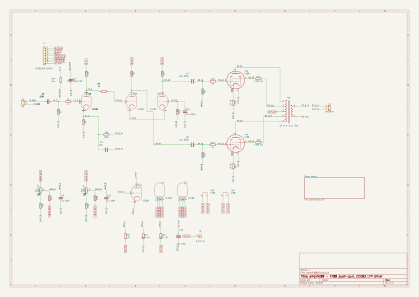
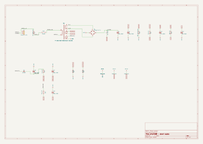
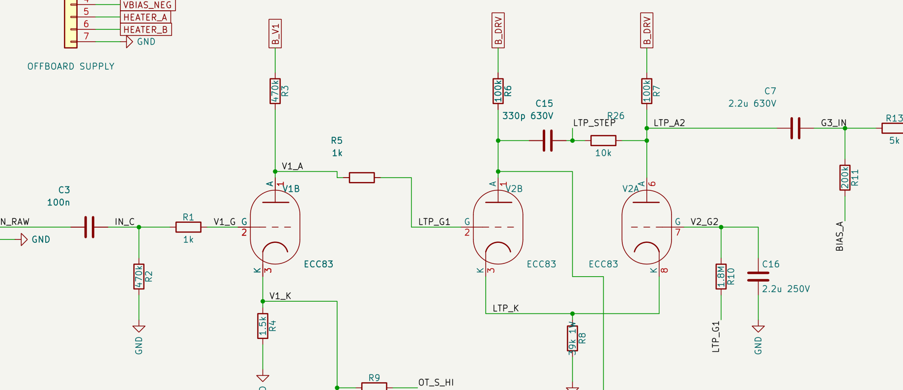
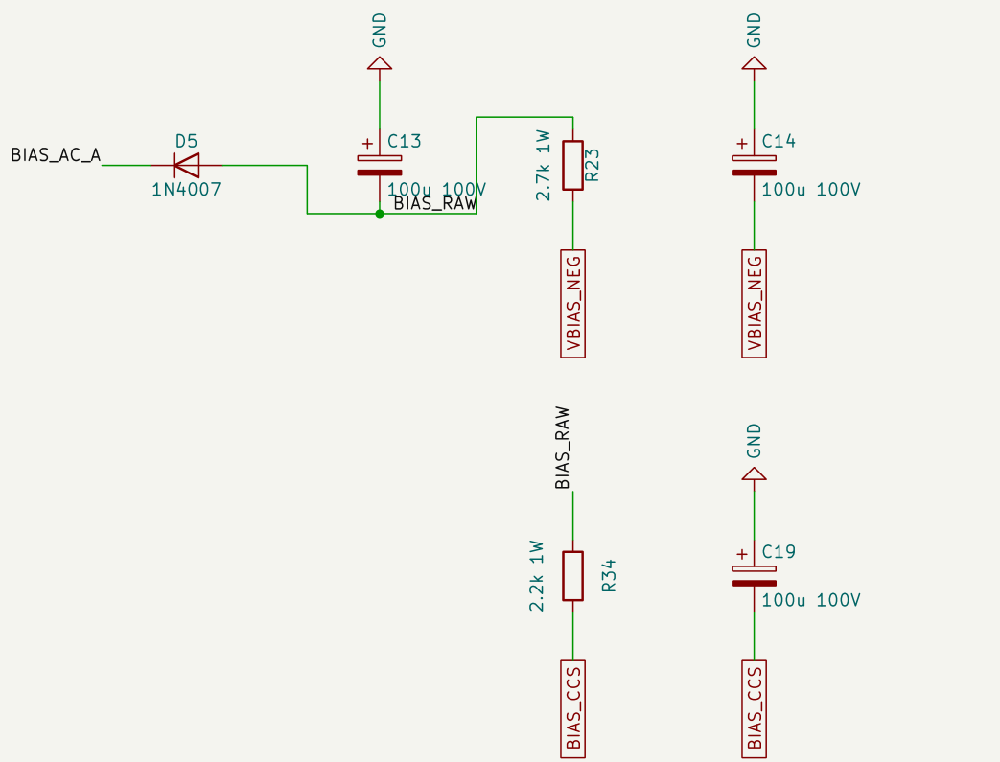
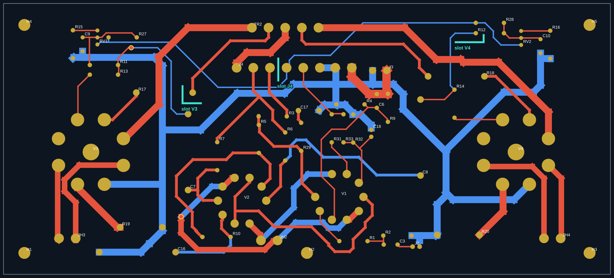
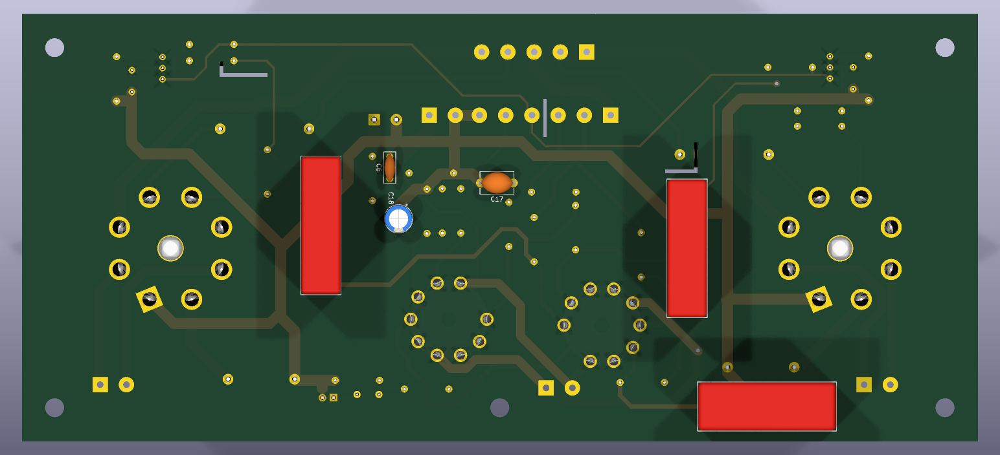

# amplikt88

Mono power amplifier, schematic in KiCad 10, two sheets (PDF of both in `amplikt88.pdf`):

- `amplikt88.kicad_sch`: the amplifier (input, driver, output stage, bias trimmers).
- `power.kicad_sch`: the power supply (mains, rectifier and filter, driver rail, negative bias supply, heater centre tap).

The nets that cross between the sheets are global labels: `B_PLUS`, `B_DRV`, `B_V1`, `VBIAS_NEG`, `HEATER_A`, `HEATER_B`.

## Schematic

### Changes of 2026-11-21: lag moved to V1's anode, spare V1 triode as the pair's tail current sink

| Driver before (R8 tail, C15/R26 across the pair's anodes) | Driver after (R29 15k + C17 180p at V1's anode) |
|---|---|
|  |  |

| Tail sink: spare V1 section, R31-R33, C18 (BIAS_CCS in on J4 pin 5) | BIAS_CCS feed on the power sheet: R34 + C19 off C13 |
|---|---|
|  |  |

Why, and the simulated before/after figures: [spare-triode comparison](docs/research/amplikt88-innovation/spare-triode-comparison.md#implemented-in-the-schematic-2026-11-21). The PCB has the new parts placed but not yet routed.

- **Output stage:** 2x KT88, push-pull, class AB, ultralinear (screens on the output transformer taps), adjustable fixed bias.
- **Driver:** ECC83 long-tailed pair, direct coupled to the input stage as in the Mullard 5-10 and 5-20 ([references](#references)): the first grid sits on V1's anode (about 89 V, through R5, a 1k grid stopper) and the tail is a constant-current sink: the spare section of V1 (pins 6/7/8), anode on the pair's cathodes, 13k (R31) from its cathode to BIAS_CCS (about -76 V), grid held at about -46 V by R32/R33 (604k/392k) and C18. It sinks 2.33 mA, so the pair's current no longer depends on V1's anode voltage, and the two outputs balance to about 0.05 %. BIAS_CCS comes from the bias supply's reservoir C13 through R34 2.2k and C19 on the power sheet, before R23, so the KT88 bias rail moves only about 2 V and a fault in the sink barely touches it ([study](docs/research/amplikt88-innovation/spare-triode-comparison.md#spare-triode-as-v2-tail-current-sink)). The second grid takes the same DC through R10 (1.8M, under the 2M the Philips data sheet allows for an ECC83 with cathode bias) and is held at AC ground by C16 (2.2 uF), so the pair works as a phase splitter. Anode loads R6 and R7 are 100k, about 1.15 mA per triode at -1.8 V bias. The KT88 grid resistors R11 and R12 are 200k, so the pair sees about 67k of AC load (see the bias note below for why 200k is allowed).
- **Input stage:** ECC83 section (the second section is grounded), 470k anode load from its own decoupled rail (B_V1, about 355 V), anode at about 89 V because it also sets the bias of the pair. Its cathode resistor R4 (1.5k) is not bypassed and takes the global feedback; it biases V1 at about -0.85 V, near the data sheet's typical point (100 V, -1 V, 0.5 mA).
- **Feedback:** 180k with 12 pF in parallel, from the speaker terminal to the input stage cathode (R4, 1.5k to ground). It encloses all three stages, about 17.4 dB of loop gain.
- **Supply:** 330 V winding, bridge, C-L-C filter to about 450 V B+, separate decoupled rails for the driver (B_DRV, about 440 V) and the input stage, 6.3 V heaters with an artificial centre tap, about -65 V bias supply.

## Assumptions to confirm before building

The values were checked in simulation (below) but nothing has been measured on hardware.

- Output transformer 4 kohm plate-to-plate with 40 % ultralinear taps and an 8 ohm secondary, 70 W. The full specification, with what happens with other transformers, is in [docs/output-transformer.md](docs/output-transformer.md).
- Power transformer 230 V, 330 V / 500 mA AC HV (330 V at full load), 6.3 V / 4.5 A, 60 V bias winding. Choke L1 5 H / 300 mA, 80 ohm or less. If a transformer is rated in DC mA for capacitor input, 300 mA DC is about the same thing.
- Bias supply: the rail carries about 5.3 mA (the two trimmer strings, 25k each, and R27, R28); the LTP tail no longer hangs on it. With the earlier 50 V winding, an 8 mA load and R23 4.7k the rail sat at about -43 V instead of -65 V, too little to bias the KT88s. With 60 V and R23 2.7k it is about -67 V at nominal mains (-60 V to -74 V for 54 to 66 V on the winding), from a time-domain model of the half-wave supply with its real load; the amplifier simulation still uses an ideal -65 V source.
- The secondary must be phased so the speaker terminal is in phase with the input. If the gain rises or it oscillates, swap the secondary leads.
- Sensitivity is high: 0.23 V peak (0.16 V rms) gives 37 W. Put a volume control or an input divider in front of C3.
- Bias trimmers: with R15 and R16 at 27k the wiper goes from -65 V to about -48 V (-67 V to -49.5 V with the rail at its nominal -67 V), a 26 % range against the 25 % the Genalex data sheet asks for. Set both fully to the most negative end before first power-up, then raise the bias to about 60 mA per valve, measured across the 1 ohm cathode resistors (60 mV). In simulation 60 mA is at -55.8 V, 54 % of the travel (the data sheet gives about -59 V for 50 mA at 460 V). At the hot end of the travel a KT88 draws about 100 mA (45 W on the anode): too much to leave it there, but not the 190 mA (85 W) that 15k allowed. With low mains (-60 V rail) 60 mA moves to about 26 % of the travel, with high mains (-74 V) to about 94 %; B+ moves with the mains too, so the real shift is smaller. Do not set more than about 75 mA: the 200k grid resistors are within the data sheet only while Pa + Pg2 stays under 35 W (220k fixed bias limit; 100k above 35 W). R27 and R28 (220k, from each wiper to VBIAS_NEG) make a trimmer fail safe: if its wiper loses contact, the grid goes to the full negative rail instead of floating. They shift the positive end of the travel by under 1 V.
- Warm-up: the input stage and the pair are direct coupled, so until V1 conducts its anode, and the grids of the pair, sit near B_V1 (355 V); the grid current is limited by R3 (470k) and R5, as in the Mullard 5-10 and 5-20 with their EF86. C16 then charges through R10 (1.8M, about 4 s), and until it has the pair is unbalanced. Watch the output at switch-on for a thump.
- Supply current: about 125 mA at idle, but 226, 260 and 270 mA average with a sine at 40, 60 and 70 W (the data sheet gives 2 x 140 mA at full signal). With a bridge into a capacitor the HV winding carries its current in short pulses, so its rms current is about twice the DC: `spice/psu_study.py` gives 285 mA at idle and 467, 525 and 542 mA at 40, 60 and 70 W. The first drawing had a 300 mA winding, 87 % loaded at idle and 1.4 to 1.6 times its rating with a sine above 40 W, and a 250 mA choke, exceeded from about 50 W; it is now 500 mA and 300 mA. The winding stays within its rating up to about 55 W of continuous sine and 5 to 8 % over at 60 to 70 W, which only a bench test reaches: music averages a small fraction of the peak power. B+ sags from 447 V at idle to 417 V at 70 W (436 V to 392 V with the 300 mA winding); the amplifier simulation uses an ideal 450 V, so the real power at the top will be a little lower.
- Capacitor voltages: with the valves cold the rectifier is unloaded and B+ rises to about 470 V, over 500 V with high mains. The reservoir capacitors are drawn as 550 V parts (or two 350 V in series with balancing resistors), the driver rail ones as 500 V with a 550 V surge rating, the coupling capacitors as 630 V.

## Safety

B+ is about 450 V and the reservoir capacitors hold charge after power-off. The 100k bleeder takes minutes to bring them down, so measure before touching.

## Notes on the schematic

- The valves are drawn as round symbols, as in period schematics. The ECC83s are KiCad's `Valve:ECC83`, in three units: two triodes and the heater. The KT88 (two units: beam tetrode and heater) and the two transformers (coils and core, polarity dots) are in `amplikt88.kicad_sym`, with the real pin numbers. KT88 pin 1 (shell) is grounded; the valve has no pin 6.
- The spare triode of V1 has grid and cathode grounded and the anode left open. ERC warns about its cathode on the ground net (a bidirectional pin next to the power flag); that warning and the one for the single `CHASSIS` label are expected.
- Short nets within a stage are drawn as wires (routed with `route_nets`, `max_length` 110 mm). The ones that cross the sheet, such as B+, the heater lines and the negative bias rail, stay as net labels.

## PCB

The board follows the schematic, direct-coupled driver included: R5 is the 1k grid stopper from V1's anode to the first grid of the pair, R10 runs from the second grid to the first, the tail sink (spare section of V1 with R31-R33, C18) and the lag network R29/C17 replace R8, C15 and R26 (**work in progress: the new parts are placed in a 20 mm strip added at the bottom of the board but not yet routed; see the [routing checklist](docs/research/amplikt88-innovation/spare-triode-comparison.md#pcb-status-parts-placed-routing-left-to-do-by-hand)**), C16 is 2.2 uF 250 V (18 x 8 mm, 15 mm pitch) and C7 and C8 2.2 uF 630 V (31.5 x 17 mm). `/LTP_G1`, `/V2_G2` and `/LTP_K` sit at about 90 V and are in the HV net class.

`amplikt88.kicad_pcb`, 218.67 x 116.5 mm (96.5 mm before the 20 mm strip for the tail sink and lag network, routing pending), two layers. The board stands vertically on an L bracket, so the valves are horizontal. All parts are on the valve side except the film capacitors C7, C8 (2.2 uF 630 V) and C16 (2.2 uF 250 V), which are on the back, away from the heat of the KT88 glass: C7 and C8 would otherwise sit right under the bulbs, C16 next to V3. C7 and C8 are about 26 mm tall, so the back needs at least that much free space plus insulation: their leads carry up to about 550 V at switch-on, C16's about 90 V. The KT88s sit at the two ends, 153.2 mm apart on the horizontal centre line: V3 on the left, turned -22.5 degrees, and V4 on the right, turned 67.5 degrees. The transformer wire pads TR2 run along the middle of the top edge (A1, UL1, CT, UL2, A2 at 6 mm pitch). The secondary pads (0, S) and the speaker terminal J3 are below them on the right. The supply wire pads J4 are 20.75 mm below TR2: B+ (pin 1) on the left, then B_DRV, B_V1, VBIAS_NEG, BIAS_CCS (pin 5, the tail sink's -76 V rail) and ground (pin 6) on the right, one 6 mm step further out: J4 is six pads (`Supply_6`, the old seven-pad `Supply_7` without the former heater pad). Both ECC83s are in the lower half of the centre, the LTP (V2) under J4 and the input valve (V1) to its right, with the input header J2 on the bottom edge next to it. Each bias trimmer (Bourns 3296X, side adjust) is in the top corner on its own valve's side, RV1 next to V3 and RV2 next to V4; the wiper safety resistors sit beside them along the top edge, R27 right of RV1 and R28 left of RV2. C16, the bypass of the LTP's second grid, lies on the back below C7 at the left of V2, above R19: its ground end sits on the B.Cu ground star, and its grid end runs on F.Cu to V2 pin 7 and on to R10. The 1 ohm cathode resistors are along the bottom edge (R19 left, R20 right). Five M4 mounting holes: one in each corner, 7.5 mm from the sides and 7.75 mm from the top and bottom edges, so the outline is symmetric about them, and H2 in the middle of the bottom edge, on the board's vertical centre line and level with H1 and H3.

Footprints: the KT88s are on `Valve_Octal_KT88` (project library `amplikt88_board`), with the pads on the solder tabs of the socket in the JJ 3D model (25.3 mm circle, 3.2 mm holes for the 2.9 x 0.5 mm tabs, origin at the socket centre) and the courtyard set to the glass, 52 mm across; the ECC83s are on `Valve_Noval_ECC83`, the tabs of a noval PCB socket on a 17.4 mm circle with 2 mm holes, courtyard the 21.5 mm glass; the 2 W screen resistors R17 and R18 on DIN0617 (17 x 6 mm), the 1 W cathode resistors R19 and R20 on DIN0414 (11.9 x 4.5 mm). The transformer pads use `OT_7`, the supply pads `Supply_6` and the heater pads `Heater_2`. J3 is a 5.08 mm screw terminal.

Heaters are wired off the board. Each valve has a pair of wire pads (JH1 to JH4, HEATER_A and HEATER_B) next to it, and the heater wires run from the transformer's 6.3 V winding straight to them (J4 pins 5 and 6 used to be the heater junction; pin 5 now carries BIAS_CCS and the sixth pad was removed). DRC therefore reports 4 unconnected heater items; that is intended.

Routing is one layer per net, with no vias:

- B.Cu carries only ground, as a star from J4 pin 6 (ground): 2.5 mm wide (1 mm into J2, whose 2.54 mm header has no room for more, between the pads of C3).
- Everything else is on F.Cu:
  - KT88 anodes to TR2 A1/A2, B+ to the centre tap and the cathodes to their 1 ohm resistors: 2.5 mm.
  - Secondary to the speaker terminal: 3 mm (3 A rms, 4.2 A peak, at 70 W into 8 ohm).
  - Heaters from each valve to its JH pads: 2 mm.
  - B_DRV, B_V1, ultralinear taps, screens and the ECC83 anodes: 1 mm.
  - Signals and the bias network: 0.5 mm.
- The one exception is `/LTP_A1` (LTP anode to C8). The parts around V1 close it in, so it takes two vias and a 13 mm jump on B.Cu.
- All tracks are at 0, 45 or 90 degrees.

Rules (net classes in `amplikt88.kicad_pro`, custom rules in `amplikt88.kicad_dru`):

- Clearance to ground copper and to the mounting holes (the screws go to the chassis) depends on the working voltage: 5 mm for B+, B_DRV, B_V1, the ECC83 anodes and the grids and cathodes of the pair (up to 470 V DC); 6.3 mm for the UL taps and screens (peaks around 650 V); 8 mm for the KT88 anodes (peaks around 900 V). The HV nets keep 2.5 mm between themselves.
- No edge touches the bracket or the chassis, so there is no HV rule at the board edge, but every track stays at least 3 mm from it.
- Minimum widths as above for the high-current and ground nets; ground only on B.Cu, every other net only on F.Cu; no vias except the named `/LTP_A1` exception.
- Pins of the same valve socket only need 1.2 mm: their spacing is set by the valve.
- No other part within 4 mm of a KT88's glass. The exceptions are R11, R13 and R17 at V3 and R14, R18 and R20 at V4. These were checked in 3D: they sit under the bulb, where the KT88 is only its 42 mm base up to 35 mm high. The heater pads JH1 to JH4 are also excluded from the courtyard checks against their valves; they are flat wire pads, also checked in 3D.

DRC: no errors and no warnings. The only unconnected items are the 4 heater ones (intended, see above). The KT88 socket outline in `Valve_Octal_KT88` is a 33.2 mm circle, so it clears the square pin 1 pad.

Schematic parity reports the power supply parts as missing (the supply is built off this board), the five mounting holes H1 to H5 as extra (they have no symbol), and the `Sim.Device` fields as missing from the footprints. All three are expected.

## Simulation

The [circuit research and innovation review](docs/amplikt88-innovation-review.md) compares uses for V1's unused triode, driver/feedback alternatives and supply/protection improvements. It also identifies historical documentation conflicts and simulation-method limitations that must be resolved before comparing new variants; the results below have not been independently rerun by that review. The [spare-triode comparison](docs/research/amplikt88-innovation/spare-triode-comparison.md) simulates parallel, cascode and cathode-follower uses of V1's spare section. It finds the 10 kHz power limit comes from C15/R26 loading V2, and that a 15 k + 180 pF lag at V1's anode removes it. The best use of the spare section is then as V2's tail current sink, fed from the bias supply's raw node.

`python3 spice/simulate.py` exports the SPICE netlist from the schematic with `kicad-cli` and runs ngspice on it (`--ltp ecc82`, `--rf`, `--cf` to try variants). The symbols carry `Sim.*` fields that point at `spice/amplikt88.lib`, so the same circuit also loads in KiCad's own simulator once B+, bias and a source are added. The power sheet is excluded; B+ (450 V) and the bias rail (-65 V) are ideal sources. `python3 spice/psu_study.py` simulates the HV supply on its own (transformer, bridge, C1, L1, C2) with the amplifier's average current as the load.

`python3 spice/plot.py` redraws the plots above (needs matplotlib).

Results for the schematic as drawn, 8 ohm load:

| | |
|---|---|
| Idle | 60 mA per KT88, grid -55.8 V; input stage 0.6 mA, anode at 89 V, cathode 0.84 V; 1.15 mA per triode in the pair, cathodes at 91 V (grid -1.83 V), 233 V anode to cathode |
| Loop gain at 1 kHz | 17.3 dB |
| Phase margin / gain margin, top of the band | 102 deg / 28 dB (unity at 45 kHz); into 100 nF / 1 uF: 94 / 62 deg |
| Phase margin / gain margin, bottom of the band | 82 deg / 33 dB (unity at 1.2 Hz) |
| Closed-loop response, -3 dB | 3.5 Hz to 32 kHz |
| Output impedance at 1 kHz | 0.56 ohm (10.4 ohm without feedback), measured before the lag move and the tail sink; the loop gain is unchanged |
| 37.3 W at 1 kHz | 0.078 % THD (0.11 % with the R8 tail and C15/R26) |
| 10 W / 37 W at 10 kHz | 0.38 % / 0.51 % THD (before: 2.0 %, and clipping at about 16.6 W) |
| Balance of the pair's outputs | 0.05 % (1.6 % with the R8 tail) |
| Power at 1 % THD | 60 W (75 W at 5 %), limited by the KT88s: their grids reach 0 V at about 60 W |
| Grid of the pair at 50 / 60 / 70 W | -0.93 / -0.81 / -0.55 V at its most positive (before the 2026-11-21 changes, not re-measured) |
| 10 kHz square, 8 ohm / + 0.1 uF / + 1 uF | 0.6 % / 0.5 % / 19.4 % overshoot (see note) |

Note on the 1 uF square wave: `simulate.py` drives it hard (12 V steps), and before the lag move it gave 3.2 % because C15/R26 current-limited the pair on the fast edges, so the step was slew-limited and the ringing hidden. At small signal (`spice/compare_before_after.py`, 4 V steps), where nothing slews, it was 15.4 % before and is 15.0 % now, and the loop's phase margin into 1 uF went from 55 to 62 degrees. If the large-signal figure matters, 22k + 220 pF for R29/C17 rings about 7 % at 27 kHz bandwidth (tuning map in the [study](docs/research/amplikt88-innovation/spare-triode-comparison.md)).

`python3 spice/compare_before_after.py --check` runs the same bench on the schematic before the change (`spice/results/v1-parallel/schematic-before.cir`) and as drawn, and fails if THD, capacitive-load margin or 1 uF ringing got worse. `python3 spice/simulate.py --netlist FILE` runs on a netlist exported elsewhere (for example on a machine without kicad-cli).

What the simulation changed:

- The first drawing returned the feedback to the second grid of the pair. That encloses only the pair and the output stage, and the loop gain was -2 dB, so it did nothing. It now returns to the input stage cathode.
- With 47k / 47 pF the loop gain is 24 dB and the amplifier rings with a capacitive load (85 % overshoot with 0.1 uF and 125 % with 1 uF before the compensation below, 12 % and 25 % with it) and has 33 degrees of phase margin at the bottom. 120k / 18 pF trades 8 dB of feedback for stability.
- The first values were only checked at the top of the band. At the bottom the two coupling networks and the transformer's inductance left 13 to 30 degrees of phase margin, with a peak of 7 to 13 dB at 2 to 5 Hz. C5 was then 1 uF into 1M (R5), C7 and C8 1 uF into 100k (R11, R12, the data sheet's limit for fixed bias at full dissipation), C3 100 nF: one corner far below the other two. C5 has since gone (direct coupling, below). `simulate.py` reports the margins at both ends.
- Compensation: the transformer's leakage inductance was the only thing rolling the loop off, so the margin depended on the transformer and on the load. With a low-leakage transformer and 0.1 uF across the speaker the square wave overshot 70 %, and a larger C6 made it worse. C15 (680 pF) in series with R26 (4.7k) between the two anodes of the pair now rolls the loop off before the transformer does: 2 % overshoot or less with any of the three loads, and with transformers from 5 to 24 mH of leakage. The price is bandwidth, 27 kHz at -3 dB.
- C16 (1 uF across R10, the second grid of the pair to ground): without it the grid was not at AC ground. The anode-grid capacitance of the second triode, multiplied by its gain (Miller, about 40 pF), against R10's 470k put a pole near 8 kHz: the grid followed 11 % of the input signal at 1 kHz and 55 % at 50 kHz, so the two anodes drifted apart (0.63 balance at 50 kHz instead of 0.83). C16 holds it down, and the THD at 38 W goes from 0.31 to 0.26 %. That pole had also been rolling the loop off, unseen: with C16 and the old compensation (470 pF with 10k) the loop crossed unity at 116 kHz instead of 29 kHz, and a 5 mH transformer with 0.1 uF across the speaker overshot 35 %. More C15 alone did not move the crossing, because R26 left a shelf of loop gain still above 0 dB; R26 down to 4.7k does. 680 pF with 4.7k is the compromise: 110 degrees of phase margin or more and 18 dB of gain margin with any transformer inside the order sheet, against 1 nF with 4.7k (20 kHz, 0.34 % THD) and 470 pF with 3.3k (40 kHz, but 42 degrees with 40 mH and 2 nF).
- Drive: the data sheet asks 57 V peak on each grid for 70 W. With 1 mA per triode (33k tail to -65 V) the pair ran out at about 45 V; at 1.5 mA (22k to -65 V) it gave 49 V at 2 % and 61 V at 4 % distortion before feedback (measured with the KT88 grids disconnected, as the model's KT88 starts drawing grid current above 45 V of drive, while a real one biased at -59 V does not). The direct-coupled pair (below) gives 48 V at 2 % and 59 V at 4 %. An ECC82 pair has more current but, with the lower loop gain (7 dB), 0.7 % THD at 38 W.
- Direct coupling, as in the Mullard 5-10 and 5-20, which couple the EF86 directly to the pair "to minimise low-frequency phase shifts" ([references](#references)). The pair used to be AC coupled (C5 1 uF, R5 1M to ground), with its grids at 0 V, so its tail had to go to the -65 V rail to be long: a tail to ground would have been a few hundred ohms. Now the first grid sits on V1's anode, the cathodes about 1.4 V above it, and 33k to ground is a long tail on its own. It saves one coupling network inside the loop and 3 mA on the bias rail. V1's anode had to come down from 215 V, or the pair would have been left with under 45 V from anode to cathode: R3 470k from B_V1 at 355 V (R22 150k) puts it at 95 V. To keep the bias of the pair negative at the current the drive needs, B_DRV went up (R21 3.3k, 440 V), so the triodes have 220 V across them: 1.46 mA at -1.43 V. A first try at 106 V on V1 and 1.15 mA (R21 6.8k, R22 47k, R8 47k) had more bias (-1.66 V) but only 37 V of drive at 2 %. At 57 V of drive the grids of the pair rise to -0.25 V, about 0.4 V closer to grid current than before; with no coupling capacitor that cannot turn into blocking. V1's gain went up with its load (470k), so the loop gain is 21 dB and the THD at 38 W halves, 0.29 to 0.16 %.
- With the direct coupling R10 goes from the second grid to the first (to give it the same DC), and R10 with C16 becomes a high-pass inside the loop: below 1/(2 pi R10 C16) the second grid follows the first and the pair loses gain. With 1M and 1 uF this was a third pole at the bottom (44 degrees, 18 dB of margin). Mullard says the same of C5 R8 in the 5-10 (C6 R10 in the 5-20): the time constant "should be as long as possible to provide maximum decoupling within the pass band". R10 is 2.2M and C16 2.2 uF (5 s), and C7 and C8 are 2.2 uF: 60 degrees and 29 dB with a 40 H primary, 28 degrees and 14 dB with a 300 H toroid (it was 29 degrees and 10 dB). The compensation at the top (C15 680 pF, R26 4.7k) still fits: 67 degrees and 15 dB or more with any transformer inside the order sheet.
- With 22k from the trimmer to ground the bias range was only -65 V to -44.7 V, so -45 V sat at the end of the travel. R15 and R16 went to 15k (-65 V to -39 V); with the refitted KT88 below they are 27k.
- Valve models refitted to the data sheets. The ECC83 had been Koren's published fit: at 100 V and -1 V it gave 0.10 mA against the Philips 0.5 mA. The KT88 had been fitted to one point (450 V, -45 V, 62 mA) and gave 770 mA at -5 V against the 330 mA of the JJ curve. Both are now fitted to the curves in `docs/datasheets` (see `spice/amplikt88.lib`). With the real ECC83, V1's anode fell to 67 V and the pair to 1.06 mA at 284 V anode to cathode; with the real KT88 (-56 V for 60 mA, 57 V peak of drive per grid for 70 W) the schematic gave 32 W at 1 % THD and 22 to 38 % overshoot on the square wave.
- Driver after the refit, compared on the same bench: an ECC83 pair with 100k grid resistors on the KT88s reached 0 V on its grid at about 60 W; an ECC81 pair stayed below -1.3 V up to 70 W, but needs the heaters raised (90 V heater to cathode) and gives 5 dB less feedback. The Mullard designs run the ECC83 at about 0.5 mA into 470k (5-20) or 820k (5-10) grid resistors and need only 25 V rms per side for two EL34; G.E.C. puts a push-pull 12AU7 or 6SN7 between the phase splitter and the KT88 in all its designs ([references](#references)). Raising R11 and R12 to 200k, as the data sheet allows below 35 W, lets the ECC83 do it: R6 and R7 100k, R8 39k, and V1 biased harder by R4 1.5k (with R9 180k and C6 12 pF the feedback ratio and the lead time constant stay as they were). The pair's grid is at -0.93 V at 50 W and -0.55 V at 70 W, so above about 50 W the driver, not the KT88s, may set the limit on a real valve, whose grid current starts near -1 V.
- R10 went down from 2.2M to 1.8M: the Philips data sheet allows 2M at most in the grid of an ECC83 with cathode bias, and 2M at 5 % could exceed it. C16 stays at 2.2 uF (4 s); the margin at the bottom drops by about 1 degree (44 degrees and 17 dB with a 300 H toroid).
- With the higher anode loads the old compensation (C15 680 pF, R26 4.7k) overshot 15 % on 8 ohm and 26 % with 1 uF. C15 330 pF with R26 10k brought it back to 1 % and 3 %.
- That network across the pair's anodes also starved the pair at high frequencies: at 10 kHz it drew about 1.2 mA, enough to cut one side off, and the amplifier clipped near 17 W. The lag now sits on V1's anode instead (R29 15k with C17 180 pF to ground), where the signal is 1-3 V: 37 W at 10 kHz at about 0.5 % THD, with phase margins of 102/94/62 degrees (resistive/100 nF/1 uF) against 94/76/55 before ([study](docs/research/amplikt88-innovation/spare-triode-comparison.md#the-real-hf-bottleneck-c15r26-on-v2)).

`python3 spice/ot_study.py` repeats the bench with other output transformers (primary impedance, leakage, capacitance, inductance); its tables are in [docs/output-transformer.md](docs/output-transformer.md).

Limits: the valve models are Koren fits to the data sheet curves, 5 to 12 % rms; the KT88 is about 10 % low at the knee with the grid near 0 V, and no model has grid current below 0 V or contact potential, so the driver margins are read against -1 V. The output transformer is a coupled-inductor model with assumed leakage (about 24 mH on the primary side) and 4 kohm plate-to-plate. Heaters, mains and the real supply are not modelled. Treat the numbers as a comparison between variants.

## References

The driver follows the Mullard 5-20 and 5-10: an EF86 input stage direct coupled to an ECC83 cathode-coupled phase splitter, with the global feedback into the EF86 cathode. This design keeps the topology but uses an ECC83 triode as the input stage, KT88s with fixed bias instead of EL34s with cathode bias (5-20) or EL84s (5-10), and about 17.4 dB of feedback instead of Mullard's 30 dB (5-20) or 26 dB (5-10). The KT88s need about 40 V rms per grid, against the 25 V rms Mullard designed the ECC83 pair for; the 200k grid resistors and the higher current in the pair make up the difference.

- Mullard Ltd, *Circuits for Audio Amplifiers*, first published April 1959, second edition August 1960 ([scan of the 1963 reprint](https://www.worldradiohistory.com/BOOKSHELF-ARH/Technology/Technology-General/Mullard%20Circuits%20For%20Audio%20Amplifiers.pdf)). Chapter 5, *Twenty-watt Amplifier* (page 29), is the 5-20; chapter 6, *Ten-watt Amplifier* (page 39), the 5-10. Both chapters describe the direct coupling; chapter 6 also explains how the EF86 anode voltage sets the bias of the phase splitter, and has the C5 R8 time constant quoted above. The book supersedes the earlier leaflets, so its values are the ones to compare against.
- G.E.C. Valve and Electronics Dept., *An Approach to Audio Frequency Amplifier Design*, 1957 ([scan](https://archive.org/details/An_Approach_to_Audio_Frequency_Amplifier_Design_G.E._Valve-Electronics_Dept._195)): the KT88 30 W, 50 W and 100 W fixed-bias ultra-linear amplifiers of the valve's maker, each with a push-pull driver stage after the phase splitter.
- F. Langford-Smith (ed.), *Radiotron Designer's Handbook*, 4th edition, 1953: push-pull output stages, phase splitters, negative feedback and its stability, output transformers, rectification and filtering (chapters 5, 7, 12 to 14, 21, 30 and 31).
- G. E. Valley and H. Wallman (eds.), *Vacuum Tube Amplifiers*, MIT Radiation Laboratory Series vol. 18, 1948: chapters 9 and 10 on the stability of feedback amplifiers at both ends of the band, the theory behind the R10 C16 and C15 R26 margins above.
- D. T. N. Williamson, *The Williamson Amplifier*, Iliffe 1952: the Wireless World articles of 1947 and 1949, with the output transformer requirements of a high-feedback amplifier.
- Morgan Jones, *Valve Amplifiers*: the [third edition](docs/references/morgan-jones-valve-amplifiers-3rd-edition.pdf) is available locally; the fourth edition is linked in the reference index. [docs/valve-design-notes.md](docs/valve-design-notes.md) contains earlier original design notes; the [innovation review](docs/amplikt88-innovation-review.md) adds verified source locations and proposed experiments.
- Local copies are in [docs/references](docs/references/README.md): Mullard complete and as an extract of chapters 3, 5 and 6, G.E.C. and Williamson complete, the Radiotron and Valley-Wallman chapters listed above.
- *Design for a 20-Watt High Quality Amplifier*, Wireless World, May and June 1955: the first publication of the 5-20, reprinted in the book. The 5-10 dates from summer 1954 (the book's preface).
