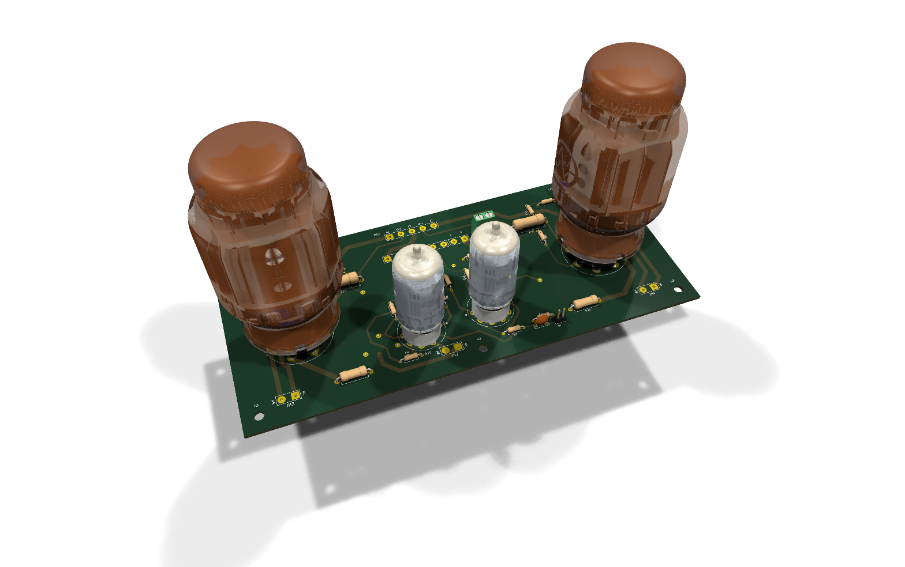
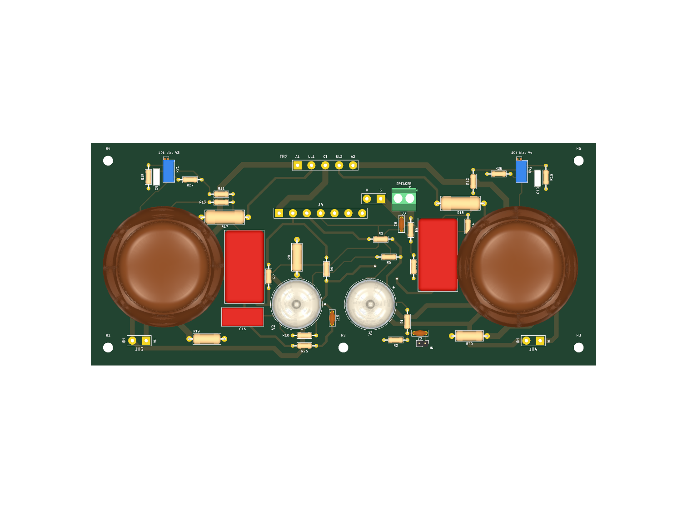
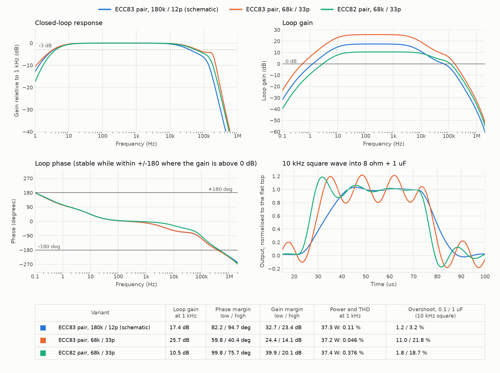

# amplikt88

Mono power amplifier, schematic in KiCad 10, two sheets (PDF of both in `amplikt88.pdf`):

- `amplikt88.kicad_sch`: the amplifier (input, driver, output stage, bias trimmers).
- `power.kicad_sch`: the power supply (mains, rectifier and filter, driver rail, negative bias supply, heater centre tap).

The nets that cross between the sheets are global labels: `B_PLUS`, `B_DRV`, `B_V1`, `VBIAS_NEG`, `HEATER_A`, `HEATER_B`.

## Schematic

- **Output stage:** 2x KT88, push-pull, class AB, ultralinear (screens on the output transformer taps), adjustable fixed bias.
- **Driver:** ECC83 long-tailed pair, direct coupled to the input stage as in the Mullard 5-10 and 5-20 ([references](#references)): the first grid sits on V1's anode (about 95 V, through R5, a 1k grid stopper) and the tail, R8 33k, goes to ground. The second grid takes the same DC through R10 (2.2M) and is held at AC ground by C16 (2.2 uF), so the pair works as a phase splitter.
- **Input stage:** ECC83 section (the second section is grounded), 470k anode load from its own decoupled rail (B_V1, about 355 V), anode at about 95 V because it also sets the bias of the pair. Its cathode is not bypassed and takes the global feedback.
- **Feedback:** 120k with 18 pF in parallel, from the speaker terminal to the input stage cathode (1k to ground). It encloses all three stages, about 21 dB of loop gain.
- **Supply:** 330 V winding, bridge, C-L-C filter to about 450 V B+, separate decoupled rails for the driver (B_DRV, about 440 V) and the input stage, 6.3 V heaters with an artificial centre tap, about -65 V bias supply.

## Assumptions to confirm before building

The values were checked in simulation (below) but nothing has been measured on hardware.

- Output transformer 4 kohm plate-to-plate with 40 % ultralinear taps and an 8 ohm secondary, 70 W. The full specification, with what happens with other transformers, is in [docs/output-transformer.md](docs/output-transformer.md).
- Power transformer 230 V, 330 V / 300 mA HV, 6.3 V / 4.5 A, 60 V bias winding.
- Bias supply: the rail carries about 5.3 mA (the two trimmer strings, 25k each, and R27, R28); the LTP tail no longer hangs on it. With the earlier 50 V winding, an 8 mA load and R23 4.7k the rail sat at about -43 V instead of -65 V, too little to bias the KT88s. With 60 V and R23 2.7k it is about -67 V at nominal mains (-60 V to -74 V for 54 to 66 V on the winding), from a time-domain model of the half-wave supply with its real load; the amplifier simulation still uses an ideal -65 V source.
- The secondary must be phased so the speaker terminal is in phase with the input. If the gain rises or it oscillates, swap the secondary leads.
- Sensitivity is high: 0.22 V peak (0.16 V rms) gives 38 W. Put a volume control or an input divider in front of C3.
- Bias trimmers: the wiper goes from -65 V to about -39 V. Set both fully to the most negative end before first power-up, then raise the bias to about 60 mA per valve, measured across the 1 ohm cathode resistors (60 mV). In simulation 60 mA is at -45 V, about 77 % of the travel. The data sheet gives about -59 V for 50 mA at 460 V, so real valves will sit nearer the negative end, with only a few volts to spare: check that 60 mA can be reached and exceeded on both valves. R27 and R28 (220k, from each wiper to VBIAS_NEG) make a trimmer fail safe: if its wiper loses contact, the grid goes to the full negative rail instead of floating. They shift the positive end of the travel by under 1 V.
- Warm-up: the input stage and the pair are direct coupled, so until V1 conducts its anode, and the grids of the pair, sit near B_V1 (355 V); the grid current is limited by R3 (470k) and R5, as in the Mullard 5-10 and 5-20 with their EF86. C16 then charges through R10 (2.2M, about 5 s), and until it has the pair is unbalanced. Watch the output at switch-on for a thump.
- Capacitor voltages: with the valves cold the rectifier is unloaded and B+ rises to about 470 V, over 500 V with high mains. The reservoir capacitors are drawn as 550 V parts (or two 350 V in series with balancing resistors), the driver rail ones as 500 V with a 550 V surge rating, the coupling capacitors as 630 V.

## Safety

B+ is about 450 V and the reservoir capacitors hold charge after power-off. The 100k bleeder takes minutes to bring them down, so measure before touching.

## Notes on the schematic

- The valves are drawn as round symbols, as in period schematics. The ECC83s are KiCad's `Valve:ECC83`, in three units: two triodes and the heater. The KT88 (two units: beam tetrode and heater) and the two transformers (coils and core, polarity dots) are in `amplikt88.kicad_sym`, with the real pin numbers. KT88 pin 1 (shell) is grounded; the valve has no pin 6.
- The spare triode of V1 has grid and cathode grounded and the anode left open. ERC warns about its cathode on the ground net (a bidirectional pin next to the power flag); that warning and the one for the single `CHASSIS` label are expected.
- Short nets within a stage are drawn as wires (routed with `route_nets`, `max_length` 110 mm). The ones that cross the sheet, such as B+, the heater lines and the negative bias rail, stay as net labels.

## PCB

**The board is one step behind the schematic.** It was laid out for the AC-coupled driver and has not been updated for the direct coupling yet; the values of C15 and R26 are the only ones already carried over. To do: C5 goes and R5 becomes the 1k grid stopper between V1's anode and the first grid of the pair; R10 now runs from the second grid to the first, not to ground; R8 (33k 1 W, DIN0414) goes to ground instead of VBIAS_NEG; C16 becomes 2.2 uF 250 V (18 x 8 mm, 15 mm pitch) and C7 and C8 2.2 uF 630 V (31.5 x 17 mm); check their height under the KT88 bulbs. `/LTP_G1`, `/V2_G2` and `/LTP_K` now sit at about 95 V, so they belong in the HV net class (5 mm to ground). The paragraph below on C16 and `/LTP_A2` describes the board as it is.

`amplikt88.kicad_pcb`, 212.67 x 90 mm, two layers. The board stands vertically on an L bracket, so the valves are horizontal. All parts are on the valve side. The KT88s sit at the two ends, 150.7 mm apart on the horizontal centre line: V3 on the left, turned -22.5 degrees, and V4 on the right, turned 67.5 degrees. The transformer wire pads TR2 run along the middle of the top edge (A1, UL1, CT, UL2, A2 at 6 mm pitch). The secondary pads (0, S) and the speaker terminal J3 are below them on the right. The supply wire pads J4 are 20.75 mm below TR2: B+ (pin 1) on the left, then B_DRV, B_V1, VBIAS_NEG, HEATER_A, HEATER_B, and ground (pin 7) on the right. Both ECC83s are in the lower half of the centre, the LTP (V2) under J4 and the input valve (V1) to its right, with the input header J2 on the bottom edge next to it. Each bias trimmer (Bourns 3296X, side adjust) is in the top corner on its own valve's side, RV1 next to V3 and RV2 next to V4; the wiper safety resistors sit beside them along the top edge, R27 right of RV1 and R28 left of RV2 (placed, not yet routed). C16, the bypass of the LTP's second grid, is placed but not routed, upright at the left of V2, between R19 and C7: its ground end sits on the B.Cu ground star, its grid end is not connected yet. The grid of V2's second triode (pin 7, R10's top end) is closed in on F.Cu by `/LTP_A2`, which runs round it from C7 down to R26, and nothing can straddle that track next to R10: a part needs 2.5 mm from the HV track at its grid end and 5 mm at its ground end, so about 10.1 mm of pitch, and the gap left between R19's ground pad and V2's pins 7 and 8 is too narrow for a second part. Routing C16 therefore needs either a named via exception for `/V2_G2` (as for `/LTP_A1`, a short jump under `/LTP_A2` on B.Cu) or a different route for the `/LTP_A2` branch to R26. The 1 ohm cathode resistors are along the bottom edge (R19 left, R20 right). Four M4 mounting holes, one in each corner, 4.5 mm from the edges.

Footprints: the KT88s are on `Valve_Octal_KT88` (project library `amplikt88_board`), with the pads on the solder tabs of the socket in the JJ 3D model (25.3 mm circle, 3.2 mm holes for the 2.9 x 0.5 mm tabs, origin at the socket centre) and the courtyard set to the glass, 52 mm across; the ECC83s are on `Valve_Noval_ECC83`, the tabs of a noval PCB socket on a 17.4 mm circle with 2 mm holes, courtyard the 21.5 mm glass; the 2 W screen resistors R17 and R18 on DIN0617 (17 x 6 mm), the 1 W cathode resistors R19 and R20 on DIN0414 (11.9 x 4.5 mm). The transformer pads use `OT_7`, the supply pads `Supply_7` and the heater pads `Heater_2`. J3 is a 5.08 mm screw terminal.

Heaters are wired off the board. Each valve has a pair of wire pads (JH1 to JH4, HEATER_A and HEATER_B) next to it, and the links between them and J4 pins 5 and 6 are external wires. DRC therefore reports 3 unconnected heater items; that is intended.

Routing is one layer per net, with no vias:

- B.Cu carries only ground, as a star from J4 pin 7: 2.5 mm wide (1.2 mm into J2, whose 2.54 mm header has no room for more).
- Everything else is on F.Cu:
  - KT88 anodes to TR2 A1/A2, B+ to the centre tap and the cathodes to their 1 ohm resistors: 2.5 mm.
  - Secondary to the speaker terminal: 3 mm (3 A rms, 4.2 A peak, at 70 W into 8 ohm).
  - Heaters from each valve to its JH pads: 2 mm.
  - B_DRV, B_V1, ultralinear taps, screens and the ECC83 anodes: 1 mm.
  - Signals and the bias network: 0.5 mm.
- The one exception is `/LTP_A1` (LTP anode to C8). The parts around V1 close it in, so it takes two vias and a 13 mm jump on B.Cu.
- All tracks are at 0, 45 or 90 degrees.

Rules (net classes in `amplikt88.kicad_pro`, custom rules in `amplikt88.kicad_dru`):

- Clearance to ground copper and to the mounting holes (the screws go to the chassis) depends on the working voltage: 5 mm for B+, B_DRV, B_V1 and the ECC83 anodes (up to 470 V DC); 6.3 mm for the UL taps and screens (peaks around 650 V); 8 mm for the KT88 anodes (peaks around 900 V). The HV nets keep 2.5 mm between themselves.
- No edge touches the bracket or the chassis, so there is no HV rule at the board edge, but every track stays at least 3 mm from it.
- Minimum widths as above for the high-current and ground nets; ground only on B.Cu, every other net only on F.Cu; no vias except the named `/LTP_A1` exception.
- Pins of the same valve socket only need 1.2 mm: their spacing is set by the valve.
- No other part within 4 mm of a KT88's glass. The exceptions are R11, R13, R17 and C7 at V3 and R14, R18, R20 and C8 at V4. These were checked in 3D: they sit under the bulb, where the KT88 is only its 42 mm base up to 35 mm high (C7 and C8, the tallest, reach 26 mm). The heater pads JH1 to JH4 are also excluded from the courtyard checks against their valves; they are flat wire pads, also checked in 3D.

DRC: no errors. There are 8 unconnected items: the 3 heater ones (intended, see above), the 4 pads of R27 and R28 and the grid end of C16, which are placed but not routed yet. There are 3 silkscreen warnings: the KT88 socket outlines clipped at pin 1 of V3 and V4, and the RV1 value text touching the C9 outline.

Schematic parity reports the power supply parts as missing (the supply is built off this board), the four mounting holes H1, H3, H4 and H5 as extra (they have no symbol), and the `Sim.Device` fields as missing from the footprints. All three are expected.

## Simulation

`python3 spice/simulate.py` exports the SPICE netlist from the schematic with `kicad-cli` and runs ngspice on it (`--ltp ecc82`, `--rf`, `--cf` to try variants). The symbols carry `Sim.*` fields that point at `spice/amplikt88.lib`, so the same circuit also loads in KiCad's own simulator once B+, bias and a source are added. The power sheet is excluded; B+ (450 V) and the bias rail (-65 V) are ideal sources.

`python3 spice/plot.py` redraws the plots above (needs matplotlib).

Results for the schematic as drawn, 8 ohm load:

| | |
|---|---|
| Idle | 60 mA per KT88, grid -45 V; input stage 0.6 mA, anode at 95 V; 1.46 mA per triode in the pair, cathodes at 96.5 V (grid -1.4 V), anodes at 319 V |
| Loop gain at 1 kHz | 21.4 dB |
| Phase margin / gain margin, top of the band | 79 deg / 21 dB (unity at 104 kHz) |
| Phase margin / gain margin, bottom of the band | 60 deg / 29 dB (unity at 0.8 Hz) |
| Closed-loop response, -3 dB | 3 Hz to 42 kHz (-1 dB: 7 Hz to 19 kHz) |
| Output impedance at 1 kHz | 0.34 ohm (8.9 ohm without feedback) |
| 37.6 W at 1 kHz | 0.16 % THD |
| Power at 1 % THD | 80 W in the model; 70 W expected from the data sheet |
| 10 kHz square, 8 ohm / + 0.1 uF / + 1 uF | 0.7 % / 0.9 % / 5.0 % overshoot |

What the simulation changed:

- The first drawing returned the feedback to the second grid of the pair. That encloses only the pair and the output stage, and the loop gain was -2 dB, so it did nothing. It now returns to the input stage cathode.
- With 47k / 47 pF the loop gain is 24 dB and the amplifier rings with a capacitive load (85 % overshoot with 0.1 uF and 125 % with 1 uF before the compensation below, 12 % and 25 % with it) and has 33 degrees of phase margin at the bottom. 120k / 18 pF trades 8 dB of feedback for stability.
- The first values were only checked at the top of the band. At the bottom the two coupling networks and the transformer's inductance left 13 to 30 degrees of phase margin, with a peak of 7 to 13 dB at 2 to 5 Hz. C5 was then 1 uF into 1M (R5), C7 and C8 1 uF into 100k (R11, R12, the data sheet's limit for fixed bias at full dissipation), C3 100 nF: one corner far below the other two. C5 has since gone (direct coupling, below). `simulate.py` reports the margins at both ends.
- Compensation: the transformer's leakage inductance was the only thing rolling the loop off, so the margin depended on the transformer and on the load. With a low-leakage transformer and 0.1 uF across the speaker the square wave overshot 70 %, and a larger C6 made it worse. C15 (680 pF) in series with R26 (4.7k) between the two anodes of the pair now rolls the loop off before the transformer does: 2 % overshoot or less with any of the three loads, and with transformers from 5 to 24 mH of leakage. The price is bandwidth, 27 kHz at -3 dB.
- C16 (1 uF across R10, the second grid of the pair to ground): without it the grid was not at AC ground. The anode-grid capacitance of the second triode, multiplied by its gain (Miller, about 40 pF), against R10's 470k put a pole near 8 kHz: the grid followed 11 % of the input signal at 1 kHz and 55 % at 50 kHz, so the two anodes drifted apart (0.63 balance at 50 kHz instead of 0.83). C16 holds it down, and the THD at 38 W goes from 0.31 to 0.26 %. That pole had also been rolling the loop off, unseen: with C16 and the old compensation (470 pF with 10k) the loop crossed unity at 116 kHz instead of 29 kHz, and a 5 mH transformer with 0.1 uF across the speaker overshot 35 %. More C15 alone did not move the crossing, because R26 left a shelf of loop gain still above 0 dB; R26 down to 4.7k does. 680 pF with 4.7k is the compromise: 110 degrees of phase margin or more and 18 dB of gain margin with any transformer inside the order sheet, against 1 nF with 4.7k (20 kHz, 0.34 % THD) and 470 pF with 3.3k (40 kHz, but 42 degrees with 40 mH and 2 nF).
- Drive: the data sheet asks 57 V peak on each grid for 70 W. With 1 mA per triode (33k tail to -65 V) the pair ran out at about 45 V; at 1.5 mA (22k to -65 V) it gave 49 V at 2 % and 61 V at 4 % distortion before feedback (measured with the KT88 grids disconnected, as the model's KT88 starts drawing grid current above 45 V of drive, while a real one biased at -59 V does not). The direct-coupled pair (below) gives 48 V at 2 % and 59 V at 4 %. An ECC82 pair has more current but, with the lower loop gain (7 dB), 0.7 % THD at 38 W.
- Direct coupling, as in the Mullard 5-10 and 5-20, which couple the EF86 directly to the pair "to minimise low-frequency phase shifts" ([references](#references)). The pair used to be AC coupled (C5 1 uF, R5 1M to ground), with its grids at 0 V, so its tail had to go to the -65 V rail to be long: a tail to ground would have been a few hundred ohms. Now the first grid sits on V1's anode, the cathodes about 1.4 V above it, and 33k to ground is a long tail on its own. It saves one coupling network inside the loop and 3 mA on the bias rail. V1's anode had to come down from 215 V, or the pair would have been left with under 45 V from anode to cathode: R3 470k from B_V1 at 355 V (R22 150k) puts it at 95 V. To keep the bias of the pair negative at the current the drive needs, B_DRV went up (R21 3.3k, 440 V), so the triodes have 220 V across them: 1.46 mA at -1.43 V. A first try at 106 V on V1 and 1.15 mA (R21 6.8k, R22 47k, R8 47k) had more bias (-1.66 V) but only 37 V of drive at 2 %. At 57 V of drive the grids of the pair rise to -0.25 V, about 0.4 V closer to grid current than before; with no coupling capacitor that cannot turn into blocking. V1's gain went up with its load (470k), so the loop gain is 21 dB and the THD at 38 W halves, 0.29 to 0.16 %.
- With the direct coupling R10 goes from the second grid to the first (to give it the same DC), and R10 with C16 becomes a high-pass inside the loop: below 1/(2 pi R10 C16) the second grid follows the first and the pair loses gain. With 1M and 1 uF this was a third pole at the bottom (44 degrees, 18 dB of margin). Mullard says the same of C5 R8 in the 5-10 (C6 R10 in the 5-20): the time constant "should be as long as possible to provide maximum decoupling within the pass band". R10 is 2.2M and C16 2.2 uF (5 s), and C7 and C8 are 2.2 uF: 60 degrees and 29 dB with a 40 H primary, 28 degrees and 14 dB with a 300 H toroid (it was 29 degrees and 10 dB). The compensation at the top (C15 680 pF, R26 4.7k) still fits: 67 degrees and 15 dB or more with any transformer inside the order sheet.
- With 22k from the trimmer to ground the bias range was only -65 V to -44.7 V, so -45 V sat at the end of the travel. R15 and R16 are 15k now (-65 V to -39 V).

`python3 spice/ot_study.py` repeats the bench with other output transformers (primary impedance, leakage, capacitance, inductance); its tables are in [docs/output-transformer.md](docs/output-transformer.md).

Limits: the KT88 model is fitted to one operating point (450 V, 60 mA, 11 mA/V), not to the datasheet curves; it needs less bias and gives more power than the real valve. The output transformer is a coupled-inductor model with assumed leakage (about 24 mH on the primary side) and 4 kohm plate-to-plate. Heaters, mains and the real supply are not modelled. Treat the numbers as a comparison between variants.

## References

The driver follows the Mullard 5-20 and 5-10: an EF86 input stage direct coupled to an ECC83 cathode-coupled phase splitter, with the global feedback into the EF86 cathode. This design keeps the topology but uses an ECC83 triode as the input stage, KT88s with fixed bias instead of EL34s with cathode bias (5-20) or EL84s (5-10), and about 21 dB of feedback instead of Mullard's 30 dB (5-20) or 26 dB (5-10).

- Mullard Ltd, *Circuits for Audio Amplifiers*, first published April 1959, second edition August 1960 ([scan of the 1963 reprint](https://www.worldradiohistory.com/BOOKSHELF-ARH/Technology/Technology-General/Mullard%20Circuits%20For%20Audio%20Amplifiers.pdf)). Chapter 5, *Twenty-watt Amplifier* (page 29), is the 5-20; chapter 6, *Ten-watt Amplifier* (page 39), the 5-10. Both chapters describe the direct coupling; chapter 6 also explains how the EF86 anode voltage sets the bias of the phase splitter, and has the C5 R8 time constant quoted above. The book supersedes the earlier leaflets, so its values are the ones to compare against.
- *Design for a 20-Watt High Quality Amplifier*, Wireless World, May and June 1955: the first publication of the 5-20, reprinted in the book. The 5-10 dates from summer 1954 (the book's preface).
