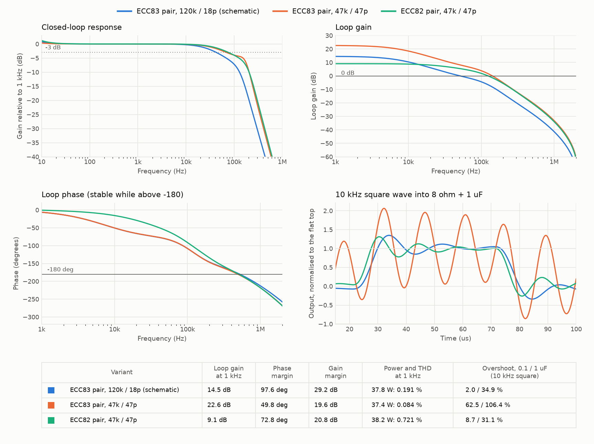

# amplikt88

Mono power amplifier, schematic in KiCad 10, two sheets (PDF of both in `amplikt88.pdf`):

- `amplikt88.kicad_sch`: the amplifier (input, driver, output stage, bias trimmers).
- `power.kicad_sch`: the power supply (mains, rectifier and filter, driver rail, negative bias supply, heater centre tap).

The nets that cross between the sheets are global labels: `B_PLUS`, `B_DRV`, `B_V1`, `VBIAS_NEG`, `HEATER_A`, `HEATER_B`.

- **Output stage:** 2x KT88, push-pull, class AB, ultralinear (screens on the output transformer taps), adjustable fixed bias.
- **Driver:** ECC83 long-tailed pair, tail returned to the negative bias rail. The second grid is grounded through 470k, so the pair works as a phase splitter.
- **Input stage:** ECC83 section (the second section is grounded). Its cathode is not bypassed and takes the global feedback.
- **Feedback:** 120k with 18 pF in parallel, from the speaker terminal to the input stage cathode (1k to ground). It encloses all three stages, about 14.5 dB of loop gain.
- **Supply:** 330 V winding, bridge, C-L-C filter to about 450 V B+, separate decoupled rail for the driver, 6.3 V heaters with an artificial centre tap, about -65 V bias supply.

## Assumptions to confirm before building

The values were checked in simulation (below) but nothing has been measured on hardware.

- Output transformer 4 kohm plate-to-plate with ultralinear taps and an 8 ohm secondary. The real transformer sets the operating point.
- Power transformer 230 V, 330 V / 300 mA HV, 6.3 V / 4.5 A, 50 V bias winding.
- The secondary must be phased so the speaker terminal is in phase with the input. If the gain rises or it oscillates, swap the secondary leads.
- Sensitivity is high: 0.24 V peak (0.17 V rms) gives 38 W. Put a volume control or an input divider in front of C3.
- Bias trimmers: the wiper goes from -65 V to about -39 V. Set both fully to the most negative end before first power-up, then raise the bias to about 60 mA per valve, measured across the 1 ohm cathode resistors (60 mV). In simulation 60 mA is at about 77 % of the travel.

## Safety

B+ is about 450 V and the reservoir capacitors hold charge after power-off. The 100k bleeder takes minutes to bring them down, so measure before touching.

## Notes on the schematic

- ECC83, KT88 and both transformers are single-unit symbols in `amplikt88.kicad_sym`, with the real pin numbers (KiCad's own ECC83 is split into three units). KT88 pins 1 and 6 are not connected.
- Short nets within a stage are drawn as wires (routed with `route_nets`, `max_length` 110 mm). The ones that cross the sheet, such as B+, the heater lines and the negative bias rail, stay as net labels.
- Resistor and capacitor footprints are not assigned yet.

## Simulation

`python3 spice/simulate.py` exports the SPICE netlist from the schematic with `kicad-cli` and runs ngspice on it (`--ltp ecc82`, `--rf`, `--cf` to try variants). The symbols carry `Sim.*` fields that point at `spice/amplikt88.lib`, so the same circuit also loads in KiCad's own simulator once B+, bias and a source are added. The power sheet is excluded; B+ (450 V) and the bias rail (-65 V) are ideal sources.

`python3 spice/plot.py` redraws the plots above (needs matplotlib).

Results for the schematic as drawn, 8 ohm load:

| | |
|---|---|
| Idle | 60 mA per KT88, grid -45 V |
| Loop gain at 1 kHz / phase margin / gain margin | 14.5 dB / 98 deg / 29 dB |
| 37.8 W at 1 kHz | 0.19 % THD, grid swing -70 V to -20 V |
| 10 kHz square, 8 ohm / + 0.1 uF / + 1 uF | 0.1 % / 2 % / 35 % overshoot |

What the simulation changed:

- The first drawing returned the feedback to the second grid of the pair. That encloses only the pair and the output stage, and the loop gain was -2 dB, so it did nothing. It now returns to the input stage cathode.
- With 47k / 47 pF the loop gain is 22.6 dB and the amplifier rings with a capacitive load (64 % overshoot with 0.1 uF, 107 % with 1 uF). 120k / 18 pF trades about 8 dB of feedback for stability.
- The ECC83 pair gives the swing needed: at 37 W each grid moves about 25 V, so the ECC82 is not needed for that. An ECC82 pair lowers the loop gain to 9 dB, which is why it rings less, but gives 0.7 % THD at the same power.
- With 22k from the trimmer to ground the bias range was only -65 V to -44.7 V, so -45 V sat at the end of the travel. R15 and R16 are 15k now (-65 V to -39 V).

Limits: the KT88 model is fitted to one operating point (450 V, 60 mA, 11 mA/V), not to the datasheet curves. The output transformer is a coupled-inductor model with assumed leakage (about 24 mH on the primary side) and 4 kohm plate-to-plate. Heaters, mains and the real supply are not modelled. Treat the numbers as a comparison between variants.
