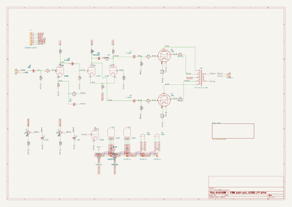
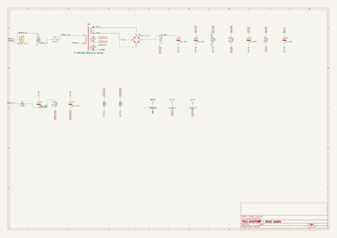
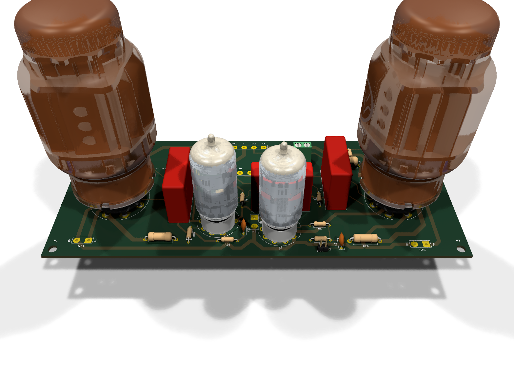
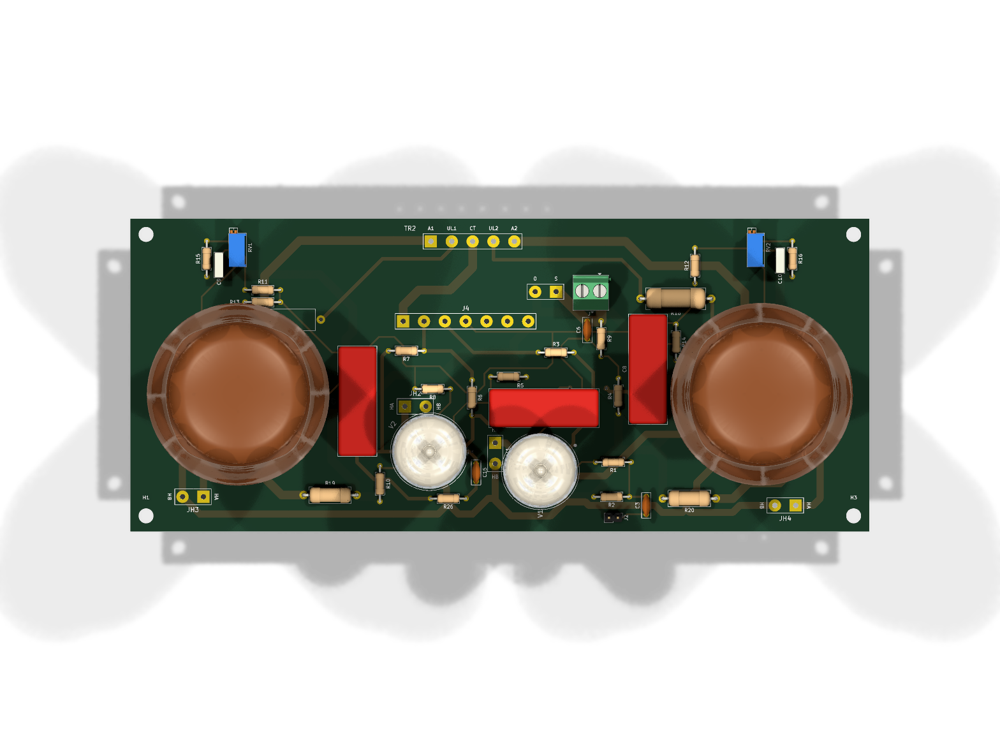
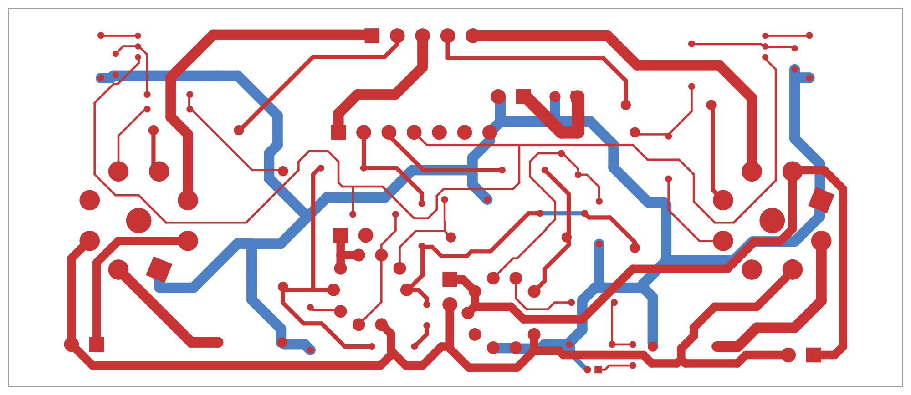
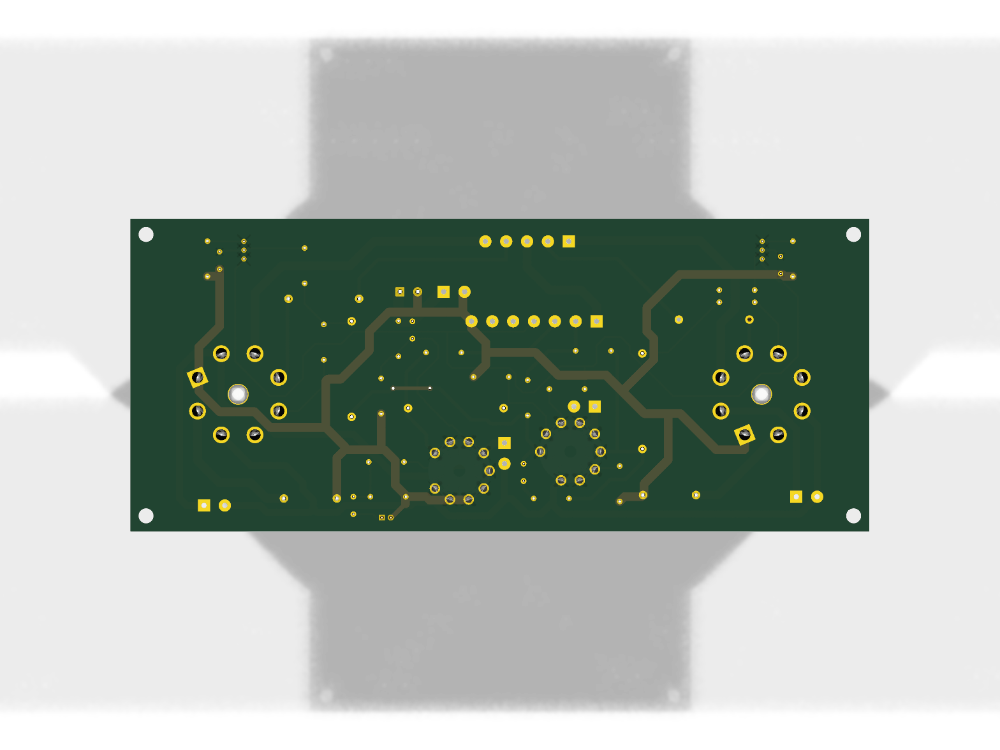

# amplikt88

Mono power amplifier, schematic in KiCad 10, two sheets (PDF of both in `amplikt88.pdf`):

- `amplikt88.kicad_sch`: the amplifier (input, driver, output stage, bias trimmers).
- `power.kicad_sch`: the power supply (mains, rectifier and filter, driver rail, negative bias supply, heater centre tap).

The nets that cross between the sheets are global labels: `B_PLUS`, `B_DRV`, `B_V1`, `VBIAS_NEG`, `HEATER_A`, `HEATER_B`.

## Schematic

- **Output stage:** 2x KT88, push-pull, class AB, ultralinear (screens on the output transformer taps), adjustable fixed bias.
- **Driver:** ECC83 long-tailed pair, tail returned to the negative bias rail. The second grid is grounded through 470k, so the pair works as a phase splitter.
- **Input stage:** ECC83 section (the second section is grounded). Its cathode is not bypassed and takes the global feedback.
- **Feedback:** 120k with 18 pF in parallel, from the speaker terminal to the input stage cathode (1k to ground). It encloses all three stages, about 16 dB of loop gain.
- **Supply:** 330 V winding, bridge, C-L-C filter to about 450 V B+, separate decoupled rail for the driver, 6.3 V heaters with an artificial centre tap, about -65 V bias supply.

## Assumptions to confirm before building

The values were checked in simulation (below) but nothing has been measured on hardware.

- Output transformer 4 kohm plate-to-plate with 40 % ultralinear taps and an 8 ohm secondary, 70 W. The full specification, with what happens with other transformers, is in [docs/output-transformer.md](docs/output-transformer.md).
- Power transformer 230 V, 330 V / 300 mA HV, 6.3 V / 4.5 A, 50 V bias winding.
- The secondary must be phased so the speaker terminal is in phase with the input. If the gain rises or it oscillates, swap the secondary leads.
- Sensitivity is high: 0.24 V peak (0.17 V rms) gives 38 W. Put a volume control or an input divider in front of C3.
- Bias trimmers: the wiper goes from -65 V to about -39 V. Set both fully to the most negative end before first power-up, then raise the bias to about 60 mA per valve, measured across the 1 ohm cathode resistors (60 mV). In simulation 60 mA is at -45 V, about 77 % of the travel. The data sheet gives about -59 V for 50 mA at 460 V, so real valves will sit nearer the negative end, with only a few volts to spare: check that 60 mA can be reached and exceeded on both valves, and lower the bias winding load (R15, R16) if not.
- Capacitor voltages: with the valves cold the rectifier is unloaded and B+ rises to about 470 V, over 500 V with high mains. The reservoir capacitors are drawn as 550 V parts (or two 350 V in series with balancing resistors), the driver rail ones as 500 V with a 550 V surge rating, the coupling capacitors as 630 V.

## Safety

B+ is about 450 V and the reservoir capacitors hold charge after power-off. The 100k bleeder takes minutes to bring them down, so measure before touching.

## Notes on the schematic

- The valves are drawn as round symbols, as in period schematics. The ECC83s are KiCad's `Valve:ECC83`, in three units: two triodes and the heater. The KT88 (two units: beam tetrode and heater) and the two transformers (coils and core, polarity dots) are in `amplikt88.kicad_sym`, with the real pin numbers. KT88 pin 1 (shell) is grounded; the valve has no pin 6.
- The spare triode of V1 has grid and cathode grounded and the anode left open. ERC warns about its cathode on the ground net (a bidirectional pin next to the power flag); that warning and the one for the single `CHASSIS` label are expected.
- Short nets within a stage are drawn as wires (routed with `route_nets`, `max_length` 110 mm). The ones that cross the sheet, such as B+, the heater lines and the negative bias rail, stay as net labels.

## PCB

`amplikt88.kicad_pcb`, 212.67 x 90 mm, two layers. The board stands vertically on an L bracket, so the valves are horizontal. All parts are on the valve side. The KT88s sit at the two ends, 150.7 mm apart on the horizontal centre line: V3 on the left, turned -22.5 degrees, and V4 on the right, turned 67.5 degrees. The transformer wire pads TR2 run along the middle of the top edge (A1, UL1, CT, UL2, A2 at 6 mm pitch). The secondary pads (0, S) and the speaker terminal J3 are below them on the right. The supply wire pads J4 are 23 mm below TR2: B+ (pin 1) on the left, then B_DRV, B_V1, VBIAS_NEG, HEATER_A, HEATER_B, and ground (pin 7) on the right. Both ECC83s are in the lower half of the centre, the LTP (V2) under J4 and the input valve (V1) to its right, with the input header J2 on the bottom edge next to it. Each bias trimmer (Bourns 3296X, side adjust) is in the top corner on its own valve's side, RV1 next to V3 and RV2 next to V4. The 1 ohm cathode resistors are along the bottom edge (R19 left, R20 right). Four M4 mounting holes, one in each corner, 4.5 mm from the edges.

Footprints: the KT88s are on `Valve_Octal_KT88` (project library `amplikt88_board`), with the pads on the solder tabs of the socket in the JJ 3D model (25.3 mm circle, 3.2 mm holes for the 2.9 x 0.5 mm tabs, origin at the socket centre) and the courtyard set to the glass, 52 mm across; the ECC83s are on `Valve_Noval_ECC83`, the tabs of a noval PCB socket on a 17.4 mm circle with 2 mm holes, courtyard the 21.5 mm glass; the 2 W screen resistors R17 and R18 on DIN0617 (17 x 6 mm), the 1 W cathode resistors R19 and R20 on DIN0414 (11.9 x 4.5 mm). The transformer pads use `OT_7`, the supply pads `Supply_7` and the heater pads `Heater_2`. J3 is a 5.08 mm screw terminal.

Heaters are wired off the board. Each valve has a pair of wire pads (JH1 to JH4, HEATER_A and HEATER_B) next to it, and the links between them and J4 pins 5 and 6 are external wires. DRC therefore reports 5 unconnected heater items; that is intended.

Routing is one layer per net, with no vias:

- B.Cu carries only ground, as a star from J4 pin 7: 2.5 mm wide (1.2 mm into J2, whose 2.54 mm header has no room for more).
- Everything else is on F.Cu:
  - KT88 anodes to TR2 A1/A2, B+ to the centre tap and the cathodes to their 1 ohm resistors: 2.5 mm.
  - Secondary to the speaker terminal: 3 mm (3 A rms, 4.2 A peak, at 70 W into 8 ohm).
  - Heaters from each valve to its JH pads: 2 mm.
  - B_DRV, B_V1, ultralinear taps, screens and the ECC83 anodes: 1 mm.
  - Signals and the bias network: 0.5 mm.
- The one exception is `/LTP_A1` (LTP anode to C8). The parts around V1 close it in, so it takes two vias and a 10 mm jump on B.Cu.
- All tracks are at 0, 45 or 90 degrees.

Rules (net classes in `amplikt88.kicad_pro`, custom rules in `amplikt88.kicad_dru`):

- Clearance to ground copper and to the mounting holes (the screws go to the chassis) depends on the working voltage: 5 mm for B+, B_DRV, B_V1 and the ECC83 anodes (up to 470 V DC); 6.3 mm for the UL taps and screens (peaks around 650 V); 8 mm for the KT88 anodes (peaks around 900 V). The HV nets keep 2.5 mm between themselves.
- No edge touches the bracket or the chassis, so there is no HV rule at the board edge, but every track stays at least 3 mm from it.
- Minimum widths as above for the high-current and ground nets; ground only on B.Cu, every other net only on F.Cu; no vias except the named `/LTP_A1` exception.
- Pins of the same valve socket only need 1.2 mm: their spacing is set by the valve.
- No other part within 4 mm of a KT88's glass. The exceptions are R11, R13, R17 and C7 at V3 and R14, R18, R20 and C8 at V4. These were checked in 3D: they sit under the bulb, where the KT88 is only its 42 mm base up to 35 mm high (C7 and C8, the tallest, reach 26 mm). The heater pads JH1 to JH4 are also excluded from the courtyard checks against their valves; they are flat wire pads, also checked in 3D.

DRC: no errors. There are 5 unconnected heater items (intended, see above) and 8 silkscreen warnings.

## Simulation

`python3 spice/simulate.py` exports the SPICE netlist from the schematic with `kicad-cli` and runs ngspice on it (`--ltp ecc82`, `--rf`, `--cf` to try variants). The symbols carry `Sim.*` fields that point at `spice/amplikt88.lib`, so the same circuit also loads in KiCad's own simulator once B+, bias and a source are added. The power sheet is excluded; B+ (450 V) and the bias rail (-65 V) are ideal sources.

`python3 spice/plot.py` redraws the plots above (needs matplotlib).

Results for the schematic as drawn, 8 ohm load:

| | |
|---|---|
| Idle | 60 mA per KT88, grid -45 V; 1.5 mA per triode in the pair, anodes at 259 V |
| Loop gain at 1 kHz | 15.9 dB |
| Phase margin / gain margin, top of the band | 113 deg / 30 dB (unity at 29 kHz) |
| Phase margin / gain margin, bottom of the band | 60 deg / 22 dB (unity at 1.6 Hz) |
| Closed-loop response, -3 dB | 3 Hz to 23 kHz (-1 dB: 6 Hz to 11 kHz) |
| Output impedance at 1 kHz | 0.6 ohm (8.9 ohm without feedback) |
| 37.9 W at 1 kHz | 0.31 % THD |
| Power at 1 % THD | 77 W in the model; 70 W expected from the data sheet |
| 10 kHz square, 8 ohm / + 0.1 uF / + 1 uF | 2.3 % / 2.2 % / 2.0 % overshoot |

What the simulation changed:

- The first drawing returned the feedback to the second grid of the pair. That encloses only the pair and the output stage, and the loop gain was -2 dB, so it did nothing. It now returns to the input stage cathode.
- With 47k / 47 pF the loop gain is 24 dB and the amplifier rings with a capacitive load (85 % overshoot with 0.1 uF and 125 % with 1 uF before the compensation below, 12 % and 25 % with it) and has 33 degrees of phase margin at the bottom. 120k / 18 pF trades 8 dB of feedback for stability.
- The first values were only checked at the top of the band. At the bottom the two coupling networks and the transformer's inductance left 13 to 30 degrees of phase margin, with a peak of 7 to 13 dB at 2 to 5 Hz. C5 is now 1 uF into 1M (R5), C7 and C8 1 uF into 100k (R11, R12, the data sheet's limit for fixed bias at full dissipation), C3 100 nF: one corner far below the other two. `simulate.py` reports the margins at both ends.
- Compensation: the transformer's leakage inductance was the only thing rolling the loop off, so the margin depended on the transformer and on the load. With a low-leakage transformer and 0.1 uF across the speaker the square wave overshot 70 %, and a larger C6 made it worse. C15 (470 pF) in series with R26 (10k) between the two anodes of the pair now rolls the loop off before the transformer does: about 2 % overshoot with any of the three loads, and with transformers from 5 to 24 mH of leakage. The price is bandwidth, 23 kHz at -3 dB; with a transformer known to be good, 220 to 330 pF gives about 30 kHz.
- Drive: the data sheet asks 57 V peak on each grid for 70 W. With 1 mA per triode (33k tail) the pair ran out at about 45 V. With R8 22k and R21 15k it runs at 1.5 mA and gives 50 V at 2 % and 63 V at 4 % distortion before feedback. An ECC82 pair has more current but, with the lower loop gain (9.6 dB), 0.7 % THD at 38 W.
- With 22k from the trimmer to ground the bias range was only -65 V to -44.7 V, so -45 V sat at the end of the travel. R15 and R16 are 15k now (-65 V to -39 V).

`python3 spice/ot_study.py` repeats the bench with other output transformers (primary impedance, leakage, capacitance, inductance); its tables are in [docs/output-transformer.md](docs/output-transformer.md).

Limits: the KT88 model is fitted to one operating point (450 V, 60 mA, 11 mA/V), not to the datasheet curves; it needs less bias and gives more power than the real valve. The output transformer is a coupled-inductor model with assumed leakage (about 24 mH on the primary side) and 4 kohm plate-to-plate. Heaters, mains and the real supply are not modelled. Treat the numbers as a comparison between variants.
