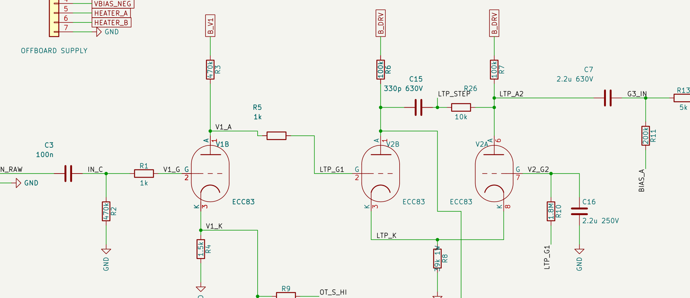
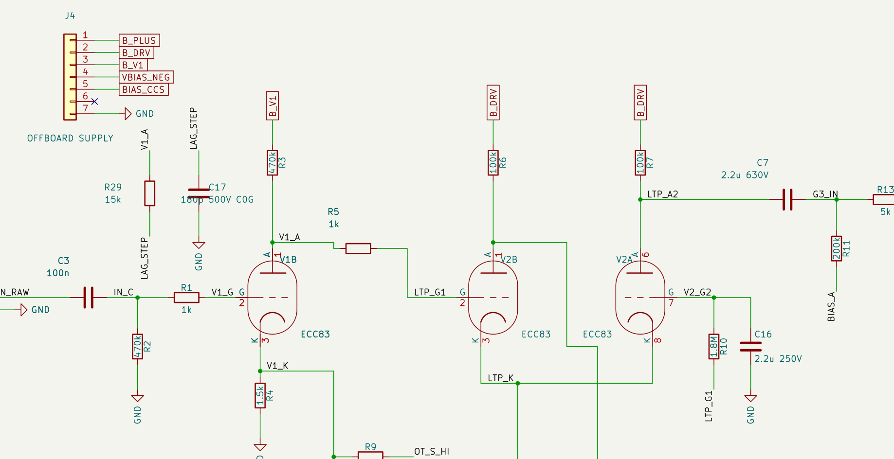
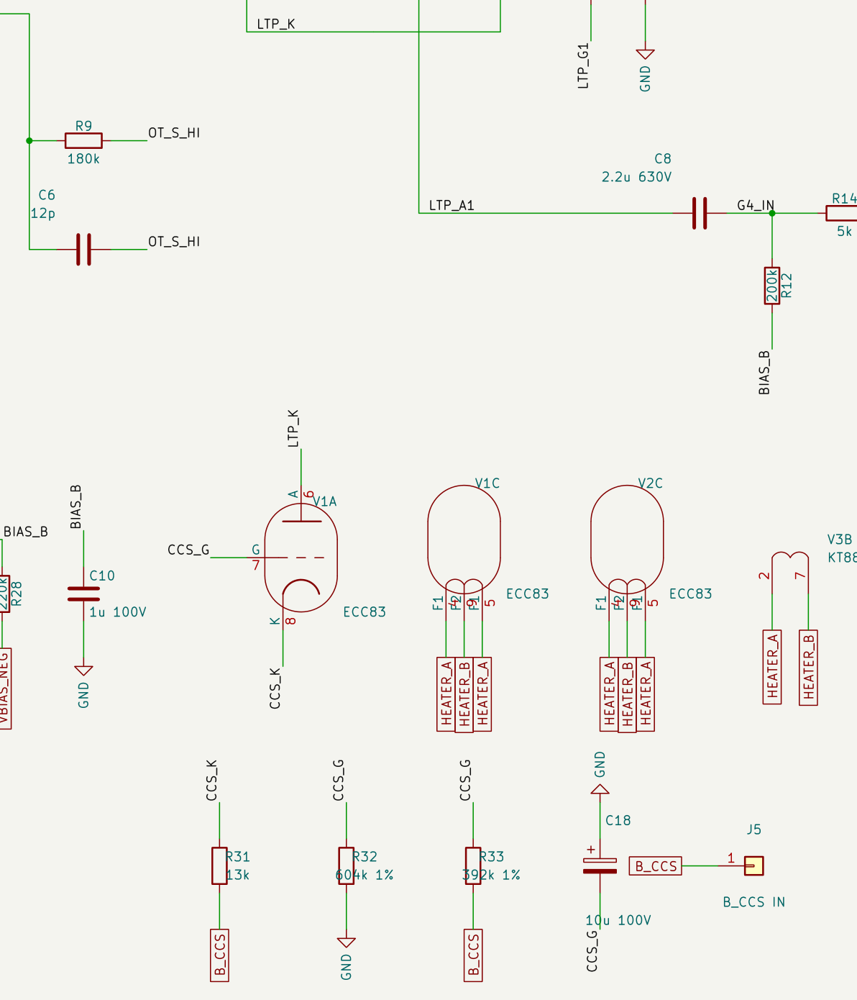
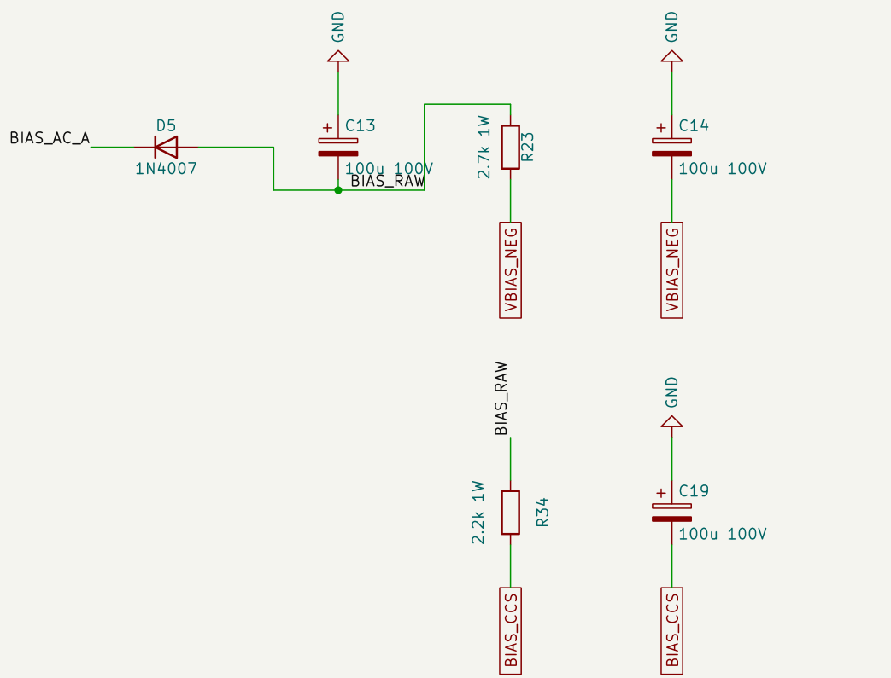

# Spare V1 triode: parallel, cascode, cathode follower and tail CCS, plus the C15/R26 fix

Simulation study of four ways to use V1's unused ECC83 section (pins 6/7/8): parallel, cascode, cathode follower and V2 tail current sink, compared against the current schematic. A separate change came out of the work: moving the HF lag compensation from V2's anodes to V1's anode. **That change is the one worth building first, and it does not need the spare triode.** Simulation only; the production schematic and PCB are unchanged.

Detail on the parallel option: [v1-parallel-results.md](v1-parallel-results.md). Options as first proposed: [innovation review §3](../../amplikt88-innovation-review.md#3-using-the-unused-v1-triode).

## Implemented in the schematic (2026-11-21)

Both recommended changes are now drawn in `amplikt88.kicad_sch` and `power.kicad_sch`. **The PCB has not been updated yet.**

1. **Lag move.**
   - Removed: C15 330p and R26 10k (across V2's anodes).
   - Added: R29 15k in series with C17 180p 500 V C0G, from V1_A to ground.
2. **V2 tail current sink.**
   - Removed: R8 39k.
   - V1's spare section (pins 6/7/8) becomes the sink: anode on LTP_K; R31 13k from its cathode to BIAS_CCS; grid on R32 604k (to ground) / R33 392k (to BIAS_CCS) with C18 10 µF.
   - On the power sheet, R34 2.2k 1 W and C19 100 µF 100 V feed BIAS_CCS from BIAS_RAW (C13, before R23).
   - BIAS_CCS reaches the board on J4 pin 5. J4 pins 5/6 used to carry the heaters; the heaters are wired off the board straight to the JH pads, and pin 6 is now unused.

| Driver, before | Driver, after |
|---|---|
|  |  |

| Tail sink (V1 spare section), after | BIAS_CCS feed on the power sheet |
|---|---|
|  |  |

**Check of the netlist as drawn** (`spice/verify_schematic.py`, with the realistic bias supply and R34/C19):

| | Result |
|---|---|
| Tail current; sink grid bias | 2.32 mA; −0.34 V |
| V1_A / LTP_K / LTP anodes | 89.3 / 91.1 / 324.6 V |
| LTP imbalance | 0.047 % |
| PM: resistive / 100 nF / 1 µF | 102° / 94° / 62° |
| 1 µF overshoot; bandwidth | 15.0 %; 32 kHz |
| THD 1 kHz: 1 W / 37 W / 60 W | 0.011 / 0.076 / 0.76 % |
| THD 10 kHz: 10 W / 37 W | 0.31 / 0.52 % |
| THD 20 kHz, 1 W | 0.08 % |

This matches `ccs_neg_lag`. ERC shows 0 errors; the one warning, the isolated CHASSIS label, was there before.

### Before/after check

`spice/compare_before_after.py --check` runs one bench on both schematic netlists (ideal rails, 60 mA trim, 8 Ω). It passes: nothing is worse.

| | Before (R8, C15/R26) | After (as drawn) |
|---|---|---|
| V1 anode / V2 cathodes | 89.3 / 91.1 V | 89.3 / 91.1 V |
| −3 dB bandwidth | 38.0 kHz | 32.4 kHz (deliberate) |
| PM: resistive / 100 nF / 1 µF | 94° / 76° / 55° | 102° / 94° / 62° |
| 10 kHz square overshoot, small signal (8 Ω / 100 nF / 1 µF) | 0.6 / 0.5 / 15.4 % | 0.7 / 0.6 / 15.0 % |
| V2 output imbalance | 1.56 % | 0.047 % |
| THD 1 kHz: 1 W / 37 W / 60 W | 0.024 / 0.107 / 0.767 % | 0.011 / 0.076 / 0.758 % |
| THD 10 kHz, 10 W | 2.24 % | 0.31 % |
| THD 10 kHz, 37 W | clips at 15.6 W (33.9 %) | 0.52 % |
| THD 20 kHz, 1 W | 0.59 % | 0.08 % |

`spice/simulate.py` also drives a large 10 kHz square wave (12 V steps). Into 1 µF its overshoot goes from 3.2 % before to 19.4 % now. The likely explanation is that the old C15/R26 network current-limited V2 on fast edges, so that large step was slew-limited and its ringing hidden; the small-signal figures above show the damping itself is unchanged or slightly better. If the large-signal figure matters, 22 k + 220 pF for R29/C17 rings about 7 % at 27 kHz bandwidth (tuning map below).

### PCB status: parts placed, routing left to do by hand

`amplikt88.kicad_pcb` has been updated from the schematic but **not routed**. What changed on the board:

- **Removed:** R8, C15 and R26 with their tracks. Also removed: the GND tracks that ran through V1 pins 7/8 (those pins now carry CCS_G and CCS_K), and the LTP_STEP tracks.
- **Board outline:** extended 20 mm downward (y 143 → 163 mm; now 218.67 × 116.5 mm). The bottom mounting holes H1/H2/H3 moved down with the edge and stay 7.75 mm from it, so **the L bracket needs its bottom holes 20 mm lower**.
- **New parts, placed in the new strip:**
  - R33 (152, 145), R32 (152, 151), C18 (144, 146), R31 (166, 145): the tail sink, under V1.
  - R29 (186, 146) and C17 (200, 146): the lag network.
- **C17 footprint:** a 7.5 mm-pitch disc (`C_Disc_D7.5mm_W5.0mm_P7.50mm`). LAG_STEP sits at V1_A's 89 V DC, so it is in the HV net class (the old `/LTP_STEP` pattern now reads `/LAG_STEP`) and needs 5 mm to GND. A 5 mm-pitch disc cannot give that between its own pads.
- **DRC:** 16 unconnected items, of which 2 are heater links between the valve heater pads (hand-wired, expected). One dangling GND stub remains on B.Cu from R2 pad 2 (163.9, 132 → 125.4); it is the end of the old GND run, to be re-joined.

Connections to route:

| Net | From → to | Class / note |
|---|---|---|
| /LTP_K | V1 pin 6 → V2 pin 3; V2 pin 3 ↔ pin 8 (that link was removed with R8's track) | HV, 1 mm, 5 mm to GND |
| /V1_A | V1 pin 1 → R29 pad 1 | HV, 5 mm to GND |
| /LAG_STEP | R29 pad 2 → C17 pad 1 | HV, 5 mm to GND |
| /CCS_G | V1 pin 7 → R33.1, R32.1, C18.2 (−) | Default, −46 V |
| Net-(V1A-K) (was /CCS_K: its label was replaced by a wire) | V1 pin 8 → R31.1 | Default, −45 V; the board still names it /CCS_K until it is updated from the schematic |
| BIAS_CCS | R31.2, R33.2 → J4 pin 5 | Default, −76 V; J4.5 takes the wire from R34/C19 on the supply |
| GND | C18.1 (+), R32.2, C17.2 → GND; re-join the GND run cut at V1 pins 7/8 (R2.2 stub, and the 193 / 116 mm track) | GND class 2.5 mm |

The automatic router (dry run) could connect everything except V1 pin 6 → LTP_K, V1_A → R29 and C18's GND pad. Those are blocked by the 5 mm HV-to-GND rule around V1.

## Summary table

All variants: ideal B+ 450 V and bias −65 V, RC driver rails as drawn, KT88 bias re-trimmed to 60 mA, 8 Ω resistive load. THD figures are at matched output power. PM is the phase margin at the upper unity-gain crossing of the loop.

| | **Baseline** | **Parallel** (scaled) | **Cascode** (raw) | **Cascode** + 150k/100p | **Cathode follower** | **Lag at V1** (no spare triode) | **Follower + lag at V1** | **Parallel + lag at V1** |
|---|---|---|---|---|---|---|---|---|
| Variant name | `baseline` | `parallel_scaled` | `cascode` | `cascode_comp` | `follower` | `baseline_lag_damped` | `follower_lag_damped` | `parallel_scaled_lag_damped` |
| Compensation | C15/R26 at V2 anodes | C15/R26 | C15/R26 | C15/R26 + step at V1_A | C15/R26 | 15k + 180p at V1_A | 15k + 220p at V1_A | 5.6k + 430p at V1_A |
| V1 output resistance | 159 k | 80 k | ~470 k | ~470 k | ~2 k (follower) | 159 k | ~2 k | 80 k |
| Loop gain @1 kHz | 17.4 dB | 17.8 dB | **27.2 dB** | 26.7 dB | 18.1 dB | 17.4 dB | 18.0 dB | 17.7 dB |
| −3 dB bandwidth (0 Ω source) | 38 kHz | 42 kHz | 76 kHz (peaking) | 32 kHz | 46 kHz | 32 kHz | 30 kHz | 31 kHz |
| Bandwidth with 47 k source | 41 kHz | **36 kHz** | 135 kHz (peaking) | 33 kHz | 51 kHz | 30 kHz | 29 kHz | 27 kHz |
| PM, resistive load | 94° | 83° | 46° | 94° | 70° | 102° | 107° | 103° |
| PM, 100 nF | 76° | 55° | **11°** | 69° | **35°** | 94° | 92° | 96° |
| PM, 1 µF | 55° | 49° | **−2° (unstable)** | 53° | 41° | 62° | 67° | 63° |
| PM, low-frequency crossing | 83° | 82° | 57° | 57° | 81° | 83° | 81° | 82° |
| 10 kHz square overshoot, 1 µF | 15.4 % | 15.2 % | 38.3 % | 11.2 % | 13.8 % | 15.5 % | 10.0 % | 13.3 % |
| THD 1 kHz, 1 W | 0.024 % | 0.023 % | 0.008 % | 0.011 % | 0.022 % | 0.025 % | 0.023 % | 0.024 % |
| THD 1 kHz, 37 W | 0.107 % | 0.106 % | 0.034 % | 0.056 % | 0.101 % | 0.093 % | 0.091 % | 0.096 % |
| THD 1 kHz, 60 W | 0.77 % | 0.76 % | 0.56 % | 0.71 % | 0.72 % | 0.76 % | 0.76 % | 0.78 % |
| THD 10 kHz, 10 W | 2.24 % | 2.25 % | 1.30 % | 2.36 % | 2.00 % | **0.35 %** | **0.32 %** | **0.36 %** |
| THD 10 kHz, 37 W | clips at ~16 W | clips | clips at ~17 W | clips at ~17 W | clips at ~16 W | **0.56 %** | **0.58 %** | **0.63 %** |
| THD 20 kHz, 1 W | 0.59 % | 0.56 % | 0.33 % | 0.58 % | 0.50 % | **0.12 %** | **0.11 %** | **0.12 %** |
| 10 kHz power at 1 % THD | ~6 W | ~6 W | ~8 W | ~6 W | ~7 W | **~46 W** | **~45 W** | **~44 W** |
| 10 kHz clipping power | ~17 W | ~17 W | ~16 W | ~17 W | ~17 W | **~58 W** | **~57 W** | **~57 W** |
| V2 LTP_K across ECC83 spread (+25 % / nominal / −20 % emission) | 84 / 91 / 98 V | 84 / 91 / 98 V | **68 / 91 / 132 V** | same as cascode | 86 / 92 / 99 V | 84 / 91 / 98 V | 86 / 92 / 99 V | 84 / 91 / 98 V |
| Extra HT current | — | +0.56 mA | +0.17 mA (divider) | +0.17 mA | +1.0 mA | — | +1.0 mA | +0.56 mA |
| Parts changed | — | 6 values, 3 pin links | 3 values, divider + cap, 1 trimmed resistor | as raw + 2 parts | 3 parts, R5 re-routed | remove 2, add 2 | follower + lag parts | parallel values + lag parts |

Bandwidth-matched versions of the lag fix (`baseline_lag` 15k/150p, `follower_lag` 12k/180p) give 38 kHz bandwidth and almost the same THD. However, they ring 23 % into 1 µF, against 15 % for the baseline, so the damped values are the ones recommended. All variants are in `summary.json`.

## What each option does

### Parallel (both sections tied, values scaled)

R3 235k, R4 750, R22 75k, C12 44 µF, R9 90k, C6 24 pF. Each section runs at the same current as now.

- V1 output resistance halves, and the white-noise floor drops about 2 dB with a low-impedance source.
- THD, power and loop gain are unchanged. The stage gain is the same by design.
- Input capacitance doubles, so with a 47 k source the bandwidth is narrower than now. The capacitive-load margin is also lower (55° vs 76° at 100 nF).
- Tying the pins without rescaling (`parallel_direct`) drops V1_A by 20 V, drags V2's operating point with it, and nearly triples the THD at 37 W.

**Verdict: neutral. Not worth a board change.**

### Cascode (spare section stacked on top of the active one)

The active section stays at the bottom: grid = input, cathode = R4 and feedback. Its anode drives the cathode of the spare section, pin 8. The spare's grid, pin 7, is held at ~47 V by 2.2 M / 263.7 k from B_DRV, with 10 µF to ground. Its anode, pin 6, takes R3 and feeds V2 as now.

- **Fitting it in:** V2 is DC-coupled and needs V1_A ≈ 89 V. With R4 = 1.5 k the lower triode alone needs ~88 V, so R4 must drop to 680 Ω (R9 82 k, C6 27 pF, keeping β). Each triode then has only ~42–47 V across it, at about −0.3 V grid bias.
- **Benefits:** loop gain rises 10 dB, so mid-band THD falls about 3× (0.034 % at 1 kHz/37 W). Input Miller capacitance becomes negligible.
- **Stability:** as built it is unstable into 1 µF (PM −2°), at 11° into 100 nF, and peaking to 76 kHz. Compensating it at V1_A (150 k + 100 pF) restores the margins. It keeps about half of the mid-band THD gain (0.056 %), but 10 kHz performance is no better, because the C15/R26 limit (below) remains. The low-frequency margin stays at 57°, against 83° for the baseline. Coupling-cap and real-PSU motorboating margins would need checking.
- **DC drift:** this is the deal-breaker. The lower triode has little cathode degeneration and the stack has no spare voltage, so V1_A swings −24/+42 V across normal valve spread, against ±7 V today.
  - A strong valve saturates the upper triode (20 V across it, grid at +0.26 V, drawing grid current).
  - A weak one lifts V2's cathodes to 132 V and drops its anodes to 267 V.
  - A 1 % change in the divider moves V1_A by about 2 V.
  - Under HF overload the average V1_A moved from 89 V to 103 V.

  With the DC-coupled V2 this would need per-valve trimming or a DC servo.

**Verdict: the best THD on paper, but impractical with this DC-coupled topology.**

### Cathode follower (spare section between V1 and V2)

R5 (1 k) becomes the follower's grid stopper from V1_A. Its cathode, pin 8, drives V2's grid directly, with 91 k to ground (~1 mA). Its anode, pin 6, has its own dropper: 100 k + 22 µF from B_DRV gives ~338 V, ~247 V anode–cathode, ~0.25 W. Its cathode sits at ~90 V, below the 180 V heater–cathode limit and the same as V2's cathodes today. V2's tail current rises about 1 % (LTP_K 92.2 V vs 91.1 V).

- It isolates V1 from V2's ~44 pF Miller load. V1 now sees only a few pF.
- **Stability without retuning:** removing that V1→V2 pole costs phase margin (35° into 100 nF), so the compensation must be retuned.
- **THD, power, noise:** barely changed. 10 kHz is still limited by C15/R26.
- **DC:** it drifts with valve spread no more than the baseline does, which is the follower's advantage over the cascode.
- It adds 1 mA of HT and 3 parts. Both sections share one envelope, so they warm up together; the cold-start behaviour matches today's direct coupling.

**Verdict: safe and sound, but the problem it was meant to fix was not the bottleneck.**

## The real HF bottleneck: C15/R26 on V2

In every variant that keeps C15 330 pF + R26 10 k across V2's anodes, the amp clips near 16–17 W at 10 kHz with the KT88 grids still at −20 V. The loop is demanding grid swing that V2 cannot deliver.

At 10 kHz C15 + R26 is about 49 k across the anodes. At ~60 V differential it takes ~1.2 mA peak, on top of the ~0.45 mA drawn by R6/R7 and R11/R12. That reaches the ~1.17 mA standing current per LTP side, so one side cuts off. The LTP differential THD reaches 8.6 % at 60 V peak, against 1 % at 93 V peak once the network is removed.

### Fix: move the lag to V1's anode

Remove C15 and R26. Add **R 15 k in series with C 180 pF from V1_A (V1 pin 1) to ground**. The step network then sits on a node that swings only ~1–3 V, so its current is a few tens of µA. V2's anodes are left to drive only R6/R7, R11/R12 and the KT88 input.

At 10 kHz:

| | Baseline (C15/R26) | Lag at V1_A |
|---|---|---|
| 10 W | 2.24 % | 0.35 % |
| 37 W | clips at ~16 W | 0.56 % |
| Clipping | ~17 W | ~58 W, the same KT88 grid-limited ceiling as at 1 kHz |
| Power at 1 % THD | ~6 W | ~46 W |

Stability is at least as good as the baseline on every measure:

| | Baseline | Lag at V1_A |
|---|---|---|
| PM, resistive / 100 nF / 1 µF | 94° / 76° / 55° | 102° / 94° / 62° |
| 1 µF square overshoot | 15.4 % | 15.5 % |
| Bandwidth | 38 kHz | 32 kHz |

THD at 1 kHz/37 W improves slightly (0.093 % vs 0.107 %), and 20 kHz/1 W falls from 0.59 % to 0.12 %.

Parts:
- **Capacitor:** C0G or silver mica, rated ≥250 V (V1_A sits at 89 V DC and the rail can reach ~355 V while V1 is cold).
- **Resistor:** ordinary 0.25 W.
- **Removed:** C15 and R26.

The R15k/150p version keeps the original 38 kHz bandwidth, but rings 23 % into 1 µF.

The cathode follower adds almost nothing on top of this fix: 0.32 % vs 0.35 % at 10 kHz/10 W, 0.091 % vs 0.093 % at 1 kHz/37 W. The lag fix alone gets ~95 % of the benefit with no extra valve section, HT current or supply branch.

### Parallel V1 plus the lag fix

Paralleled V1 (`parallel_scaled` values) halves V1's output resistance to 80 k. To keep the same corner frequencies, the lag network is rescaled to half R and double C, then tuned for margins equal to `baseline_lag_damped`. Result: 5.6 k + 430 pF from V1_A to ground (`parallel_scaled_lag_damped`).

| | Lag at V1 (single triode) | Parallel + lag at V1 |
|---|---|---|
| THD 1 kHz, 37 W / 60 W | 0.093 / 0.76 % | 0.096 / 0.78 % |
| THD 10 kHz, 10 W / 37 W | 0.35 / 0.56 % | 0.36 / 0.63 % |
| THD 20 kHz, 1 W | 0.12 % | 0.12 % |
| 10 kHz power at 1 % THD / clipping | ~46 / ~58 W | ~44 / ~57 W |
| PM: resistive / 100 nF / 1 µF | 102° / 94° / 62° | 103° / 96° / 63° |
| 1 µF square overshoot | 15.5 % | 13.3 % |
| Bandwidth, 0 Ω / 10 k / 47 k source | 32 / 32 / 30 kHz | 31 / 30 / **27 kHz** |
| White-noise floor (analytic) | 1.26 µV | 0.98 µV (−2.2 dB) |
| Extra parts / HT current | — | 6 value changes, 3 pin links / +0.56 mA |

A bandwidth-leaning version (5.6 k + 360 pF, `parallel_scaled_lag`) gives 36 kHz bandwidth, 0.090 % at 1 kHz/37 W and 0.60 % at 10 kHz/37 W. Like `baseline_lag`, it rings 22 % into 1 µF.

**Verdict:** the combination works, and it is equivalent to the lag fix alone within simulation resolution. THD is very slightly higher, the stability trade is almost identical, and the bandwidth is narrower with a high-impedance source because of the doubled input capacitance. The only real gain is about 2 dB less white noise with a low-impedance source, which hum will mask in a power amplifier. Like parallel alone, it is not worth the extra changes.

## Spare triode as V2 tail current sink

The spare section replaces R8 (39 k, ~2.33 mA from LTP_K ≈ 91 V) as a constant-current sink. Every variant is built on top of the lag fix and tuned to the same margins as `baseline_lag_damped`.

**The headroom problem.** The ECC83 is a low-current valve. Sinking 2.33 mA needs a positive grid (+0.23 V) with the ~90 V available above ground. So the sink needs more voltage, and there are two places to get it: below ground (the bias supply) or above (raise V2). Three layouts were simulated:

| | `ccs_neg_lag` (**chosen**) | `ccs_raised_lag` | `ccs_low_lag` |
|---|---|---|---|
| Idea | Return the sink below ground, to the −65 V bias supply | Lift V1_A, and with it V2, to ~155 V | Keep DC levels; cut the tail to 1.5 mA |
| V1 / V2 changes | none | R3 362k, R4 2.65k, R9 318k, C6 6.8p | R6/R7 150k |
| Sink operating point | 136 V, 2.33 mA, grid −0.33 V, 0.32 W | 145 V, 2.33 mA, grid −0.42 V | 85 V, 1.5 mA, grid **−0.19 V** |
| Sink impedance ra + (µ+1)·Rk | **~1.3 M** (33× R8) | ~515 k | ~420 k |
| V2 heater–cathode | 91 V (as now) | **156–162 V** (limit 180 V: heater elevation needed) | 92 V |
| Sink heater–cathode | 45 V (cathode below heater) | 11 V | 7 V |

### Chosen layout: sink fed from the bias supply's raw node

```text
 LTP_K (V2 cathodes, 91 V) ── pin 6
                      pin 7 ──┬── 600 k ── GND
                              ├── 393 k ──┐            (grid ≈ −45.7 V)
                              └── 10 µF ── GND
                      pin 8 ── 13 k ──────┴── BIAS_CCS (≈ −75.7 V)
                                              ├── 100 µF ── GND
 BIAS_RAW (C13, before R23) ── 2.2 k ─────────┘
 BIAS_RAW ── R23 2.7 k ── VBIAS_NEG (KT88 bias, unchanged)
```

- **Removed:** R8.
- **Added:** 13 k (cathode); 2.2 k + 100 µF / 100 V (sink supply filter); 600 k / 393 k (390 k + 3.3 k) + 10 µF (grid reference).
- **Wiring:** the BIAS_RAW node, at C13, has to reach the amplifier board. That means one more pin on J4 or a local feed.

**Why the raw node and not VBIAS_NEG.** The bias supply was modelled on its own (`bias_supply_study.py`): 60 V winding, D5 half-wave, C13, R23, C14. The winding resistance is calibrated to the README's −67 V at 5.3 mA. The rail's output resistance is ~3.1 k, almost all of it R23:
- **Sink hung on VBIAS_NEG:** the KT88 bias rail would lose ~7.5 V. At low mains it would fall to −56.5 V, which is marginal for the trimmer range. Any fault in the sink would also pull the KT88 bias directly.
- **Sink on the raw node:** the raw node is only ~380 Ω, so the KT88 rail moves ~2 V in normal use, and R23 isolates it from sink faults.

**Mains and faults.** These were run with the realistic bias network, with B+ scaled alongside (`tail_supply_study.py`).

| | R8 tail | `ccs_neg_lag` |
|---|---|---|
| Bias trimmer position for 60 mA at 0.9 / 1.0 / 1.1 mains | 0.96 / 0.83 / 0.72 | 0.92 / 0.80 / 0.69 (inside the travel) |
| KT88 bias rail at 0.9 / 1.0 / 1.1 mains | −64.2 / −71.4 / −78.5 V | −63.5 / −70.6 / −77.7 V |
| Tail current at 0.9 / 1.0 / 1.1 mains | 2.02 / 2.34 / 2.65 mA | 2.10 / 2.33 / 2.57 mA |
| KT88 current after a sink anode–cathode short (trim unchanged) | — | 66 mA (from 60) |
| After a sink cathode–heater short | — | 64 mA |
| After the sink loses emission | — (R8 open: 60 mA) | 57 mA; V2 then cuts off, as with R8 open |

None of these single faults endangers the KT88s. The tail current tracks the mains, as R8 does now, because the grid reference is a fixed fraction of the rail.

### Results

| | Lag fix, R8 tail | **`ccs_neg_lag`** | `ccs_raised_lag` | `ccs_low_lag` |
|---|---|---|---|---|
| LTP output imbalance (closed loop) | 1.54 % | **0.047 %** | 0.11 % | 0.19 % |
| Tail current across ECC83 spread (strong / nominal / weak) | 2.16 / 2.34 / 2.52 mA | **2.34 / 2.33 / 2.32 mA** | 2.36 / 2.33 / 2.29 mA | 1.52 / 1.50 / 1.48 mA |
| LTP_K across spread | 84 / 91 / 98 V | 84 / 91 / 99 V | 150 / 156 / 162 V | 85 / 92 / 100 V |
| Loop gain @1 kHz | 17.4 dB | 17.4 dB | 15.2 dB | 17.1 dB |
| PM: resistive / 100 nF / 1 µF; 1 µF overshoot | 102° / 94° / 62°; 15.5 % | 102° / 94° / 62°; 15.1 % | 99° / 93° / 62°; 15.9 % | 101° / 94° / 62°; 15.5 % |
| Bandwidth (0 Ω / 47 k source) | 32 / 30 kHz | 32 / 30 kHz | 34 / 32 kHz | 32 / 30 kHz |
| THD 20 Hz, 10 W | 0.131 % | **0.115 %** | 0.139 % | 0.106 % |
| THD 100 Hz, 37 W | 0.083 % | **0.071 %** | 0.096 % | 0.167 % |
| THD 1 kHz, 1 W | 0.025 % | **0.012 %** | 0.013 % | 0.009 % |
| THD 1 kHz, 37 W | 0.093 % | **0.075 %** | 0.094 % | 0.183 % |
| THD 1 kHz, 60 W | 0.76 % | **0.75 %** | 0.80 % | 1.10 % |
| THD 10 kHz, 10 W | 0.35 % | **0.31 %** | 0.33 % | 0.28 % |
| THD 10 kHz, 37 W | 0.56 % | **0.52 %** | 0.55 % | 0.84 % |
| THD 20 kHz, 1 W | 0.12 % | **0.08 %** | 0.09 % | 0.08 % |
| 10 kHz power at 1 % THD | ~46 W | ~46 W | ~45 W | ~40 W |

The 1 s / 512 points-per-cycle convergence runs for `ccs_neg_lag` agree: 0.074 % at 1 kHz/37 W, 0.74 % at 60 W, 0.31 % at 10 kHz/10 W.

**Verdict: `ccs_neg_lag` is the best tail option and the best use of the spare triode.**
- **Distortion:** it is the only variant that is equal or better at every level and frequency. LTP balance improves 30× and low-level THD halves; THD at 37 W falls 20 %.
- **Unchanged:** V1, V2, the loop gain, the stability margins and the bandwidth.
- **Valve spread:** the tail current stops depending on it.
- **Cost:** six small parts, one extra supply connection (BIAS_RAW), and 2.4 mA more from the bias winding.
- **Rejected:**
  - `ccs_raised` needs V1 rebiased, V2 at ~160 V with heater elevation, and gives up 2.2 dB of loop gain.
  - `ccs_low` starves V2 at full power and runs its grid at −0.19 V.

## Recommendation

1. **Build the lag move first:** remove C15/R26 and add 15 k + 180 pF from V1_A to ground. It removes the 10 kHz power limit, uses two fewer parts and no new supply, and leaves the spare triode free. Confirm on the bench with the real OT: square waves into resistive, 100 nF and 1 µF loads, and 10 kHz power at 1 % THD. Retune R/C there if needed, using the sweeps below as the starting map.
2. **Spare triode:** once the lag is moved, neither the cathode follower nor the scaled parallel connection buys measurable THD, power or stability. The parallel version gives only ~2 dB less white noise. The cascode is excluded by its DC drift. Of the four uses, only the tail sink (step 3) measurably helps.
3. **Second step, tail current sink (`ccs_neg_lag`):** once the lag fix is verified, use the spare section as V2's tail sink, returned to the bias supply's raw node. It cuts LTP imbalance from 1.5 % to 0.05 % and low-level THD by half, and improves every other THD figure slightly. It leaves V1, V2 and the margins unchanged, and it survives single faults without endangering the KT88s. Do not hang it directly on VBIAS_NEG, and do not use the low-current or raised-V2 versions.
4. **Avoid** the cascode in this topology, and parallel without rescaling.

## Tuning map for the lag network (no follower)

| R / C at V1_A | PM: resistive / 100 nF / 1 µF | 1 µF overshoot | Bandwidth |
|---|---|---|---|
| 15k / 150p | 96° / 86° / 54° | 23.4 % | 38.0 kHz |
| **15k / 180p** | **102° / 94° / 62°** | **15.5 %** | **32.4 kHz** |
| 22k / 180p | — / — / 65° | 13.1 % | 31.6 kHz |
| 22k / 220p | 109° / 95° / 73° | 6.9 % | 26.9 kHz |
| 10k / 180p | — / — / 57° | 19.4 % | 34.7 kHz |

Higher C damps capacitive loads further at the cost of bandwidth; higher R raises the crossover. A dash means that margin wasn't simulated for those values.

## Reproduce

```text
cd spice
kicad-cli sch export netlist --format spice -o results/v1-parallel/source-export.cir ../amplikt88.kicad_sch
python3 parallel_v1.py --netlist results/v1-parallel/source-export.cir --variants baseline parallel_direct parallel_scaled cascode
python3 parallel_v1.py --netlist results/v1-parallel/source-export.cir --out results/v1-parallel-x --variants cascode_comp follower follower_lag follower_lag_damped baseline_lag baseline_lag_damped parallel_scaled_lag parallel_scaled_lag_damped ccs_low_lag ccs_raised_lag ccs_neg_lag
python3 merge_results.py                     # folds results/v1-parallel-*/ into results/v1-parallel/summary.json
python3 parallel_v1_checks.py cascode cascode_comp follower follower_lag follower_lag_damped baseline_lag baseline_lag_damped parallel_scaled_lag parallel_scaled_lag_damped ccs_low_lag ccs_raised_lag ccs_neg_lag
EXTRA_PLAN=hf python3 parallel_v1_extra.py baseline parallel_scaled cascode cascode_comp follower follower_lag follower_lag_damped baseline_lag baseline_lag_damped parallel_scaled_lag parallel_scaled_lag_damped ccs_low_lag ccs_raised_lag ccs_neg_lag
python3 parallel_v1_spread.py
python3 parallel_v1_tail.py                  # LTP balance and tail spread, R8 vs triode CCS
python3 bias_supply_study.py                 # bias supply load/mains model (Thevenin used by ccs_neg)
python3 tail_supply_study.py                 # mains range and single faults with the real bias supply
python3 test_parallel_v1.py
```

Variants are defined in `variant()` in [spice/parallel_v1.py](../../../spice/parallel_v1.py). Results are in [spice/results/v1-parallel/](../../../spice/results/v1-parallel/):
- `summary.json`: DC, AC, loop, square-wave and THD for every variant.
- `checks.json` and `checks-variants.json`: source-impedance and capacitive-load loop checks.
- `extra.json` and `extra-hf.json`: THD sweeps with per-stage probes.
- `spread.json`: valve-spread DC check.
- `tail.json`: LTP balance and tail-current spread for the CCS variants.
- `bias_supply.json`, `tail_supply.json`: bias supply model, and mains/fault checks.

## Limitations

- Ideal B+ and bias supplies (except `ccs_neg`, which uses the modelled bias supply); PSU sag, ripple and LF interaction with the real supply are not modelled. This matters most for the cascode's reduced low-frequency margin.
- Simplified OT model (40 H primary, 24 mH leakage; the procurement target is ≤15 mH). The HF behaviour and the lag values must be re-verified with the real transformer.
- Koren valve models: no noise, flicker, grid emission, microphony or section mismatch. The valve-spread check scales both sections of V1 together.
- The loop gain uses single voltage injection at the secondary (Zout ≪ Z_feedback). It is not a full return-ratio measurement.
- The cascode divider (263.7 k) is solved for the nominal model valve; a real build would need a trimmer.
